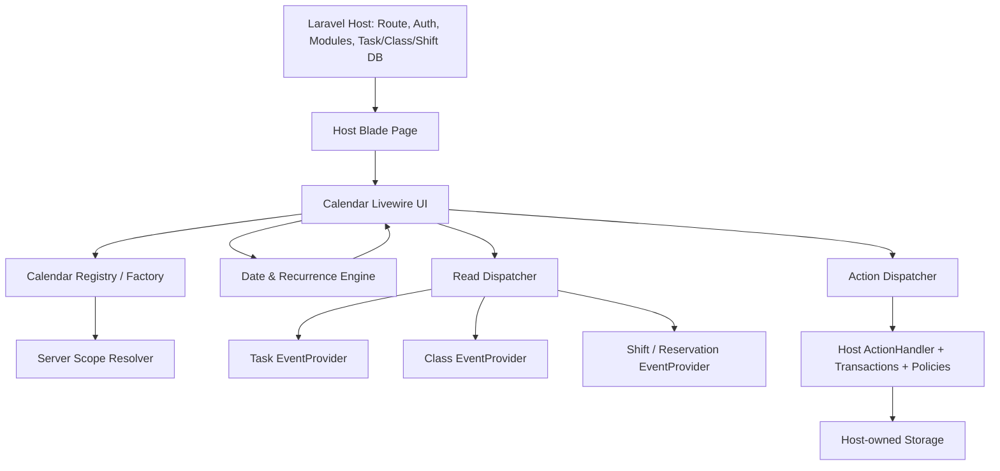

# سند صفر تا صد توسعه پکیج سازمانی تقویم Laravel — ۵ فاز تا انتشار ۱.۰

**وضعیت:** سند اجرایی قابل واگذاری به Cursor / تیم توسعه؛ نه ادعای تکمیل کد  
**نسخه سند:** ۱.۰ — ۱۵ اکتبر ۲۰۲۶  
**منبع محصولی:** `Pasted markdown(1).md` (PRD استخراج تقویم فعلی) + تصمیم‌های جدید تأییدشده درباره پکیج عمومی سازمانی  
**نام ثابت پیشنهادی:** `karnoweb/laravel-calendar`، فضای نام `Karnoweb\Calendar`، کلید‌های `calendar::` و `config/calendar.php`  
**پلتفرم انتشار اول:** PHP `^8.3`، Laravel `^13.0`، Livewire `^4.0`، Alpine همراه Livewire  
**مدل انتشار:** پنج فاز فقط برای اجرای داخلی؛ **انتشار 1.0.0 بعد از تکمیل تمام فازها و تمام تست‌ها**.

> نکته بسیار مهم: سند اولیه صرفاً رفتار واقعی تقویم شخصی فعلی را گزارش کرده و تصمیم‌های بسیاری را باز گذاشته است. هر آنچه در این سند درباره چندمنبعی، تکرار، چندروزه، لمس، آزمون سازمانی و قراردادهای جدید آمده **تصمیم طراحی جدید** بر مبنای تأیید مالک محصول است و نباید به‌عنوان «از قبل پیاده‌سازی‌شده» تلقی شود.

## روش استفاده (از مخزن خالی تا نسخه قابل نصب)

۱. این فایل، PRD اولیه و فایل `CALENDAR-CURSOR-PROMPTS-v1.0-FA.md` را در `docs/` مخزن جدید بگذار.  
۲. نام پکیج و نسخه‌های پشتیبانی را در آغاز فاز ۱ تثبیت کن؛ از تغییر نام قراردادهای عمومی در میانه کار جلوگیری کن.  
۳. فازها را از ۱ تا ۵ به ترتیب، با **دستور آماده کپی** اجرا کن؛ هر دستور باید همه فایل‌های همان فاز را تولید کند.  
۴. در پایان هر فاز، **خروجی واقعی کد، گزارش تست، گزارش فایل‌ها و موانع باقی‌مانده** ثبت شوند؛ گزارش ساختگی یا تست نوشته‌شده ولی اجرا نشده پذیرفته نیست.  
۵. فایل‌ها، مسیرهای دقیق و تست‌ها در همین سند تعریف شده‌اند؛ **نام یک فایل در این فهرست به معنی وجود آن فایل نیست**. بسته شروع همراه سند فقط زیرساخت اولیه است و تولید محصول کامل به اجرای فازها وابسته است.  
۶. تا عبور از دروازه فاز ۵، هیچ نسخه Production-ready منتشر نکن. تنظیمات قابلیت‌ها می‌توانند برای هر تقویم خاموش شوند، اما پیاده‌سازی تمام قابلیت‌های الزامی در نسخه ۱ باید وجود داشته باشد.

## واژه‌های کلیدی

- **DTO** (شیء استاندارد انتقال داده): شکل تایپ‌شده و قابل اعتبارسنجی اطلاعات.
- **Provider** (تأمین‌کننده رویداد): سرویس میزبان برای خواندن داده یک ماژول.
- **Handler** (اجراکننده عملیات): سرویس میزبان برای تأیید و ثبت تغییرات.
- **Scope** (محدوده دسترسی): شناسه‌های معتبر کاربر/سازمان و سطح دسترسی استخراج‌شده در سرور.
- **Occurrence** (یک نوبت از رویداد تکراری): نمونه خاص از یک مجموعه تکرارشونده.
- **RRULE** (قاعده استاندارد تکرار رویداد): تعریف دوره‌های تکرار، مطابق RFC 5545.
- **DST** (تغییر فصلی ساعت): ساعت تابستانی، که ممکن است زمان محلی را نامعتبر یا مبهم کند.
- **Fail-closed** (رد پیش‌فرض در ابهام): نبودن مجوز یا محدوده معتبر باعث رد عملیات می‌شود.
- **Idempotency** (مصونیت در برابر تکرار فرمان): اجرای دوباره یک شناسه عملیات اثر تکراری ایجاد نمی‌کند.
- **CI** (اجرای خودکار تست): اعتبارسنجی پروژه در هر تغییر کد.

## ۰. شرایط قطعی و غیرقابل مذاکره

| تصمیم | وضعیت نهایی |
|---|---|
| محصول | تقویم عمومی، نه مدیریت تسک یا سیستم رزرو |
| دیتابیس پکیج | **هیچ migration یا مدل دامنه اجباری ندارد** |
| ماژول/شعبه/کاربر | به مدل خاص وابسته نیست؛ Scope امن سمت سرور قابل تزریق است |
| داده | از چند Provider مستقل؛ هیچ Provider حق دسترسی خودکار به منبع دیگر ندارد |
| نوشتن داده | تمام CRUD و تغییر زمان توسط Handler پروژه میزبان انجام می‌شود |
| تقویم‌ها | شمسی و میلادی با چهار نمای ماه/هفته/روز/لیست |
| زبان و ظاهر | RTL/LTR، فارسی/انگلیسی، روشن/تاریک و Viewهای قابل جایگزینی |
| رویداد | ساعتی، تمام‌روز، چندروزه، تکرارشونده و دارای استثناء |
| عملیات | ساخت/ویرایش/حذف/جابجایی با ماوس، لمس و جایگزین صفحه‌کلیدی |
| جست‌وجو/فیلتر | چندمنبعی و امن؛ اجرای فیلتر سمت Provider برای داده حجیم |
| اعلان و یادآور | **ارسال اعلان جزو هسته تقویم نیست**؛ Hook اختیاری برای میزبان تعریف می‌شود |
| ادغام Google/Outlook | خارج از انتشار ۱؛ اتصال بیرونی نباید هسته را آلوده کند |
| تقویم آماری Viewable | خارج از دامنه بدون استثنا |
| سازگاری نرم‌افزار فعلی | رفتارهای موجود با آداپتر میزبان حفظ شوند؛ تغییر دیتابیس اصلی اجباری نیست |
| انتشار | فقط `1.0.0` پس از قبولی فاز پنجم؛ هیچ قابلیت اصلی به نسخه ۱.۱ منتقل نشود |

## ۱. نمای کلی پنج فاز

| فاز | نام | نتیجه غیرقابل جایگزینی | شرط عبور |
|---|---|---|---|
| ۱ | اسکلت پکیج و قراردادهای امن | ServiceProvider، Registry، Builder، DTO، Scope، Provider/Handler | دو تقویم مستقل بدون نشت داده و قرارداد پایدار |
| ۲ | هسته تاریخ و نمایش کامل | شمسی/میلادی، چهار نما، رندر مستقل، داده صفحه‌ای، فیلترها | مرز ماه/سال و RTL، داده زیاد و چهار نما تست شوند |
| ۳ | عملیات عمومی و رویداد تکراری | CRUD، Drag لمسی/موس/کیبورد، فرم و تأیید، recurrence/exception | نتیجه UI و سرور یکی باشد؛ هیچ تغییر بدون مجوز ثبت نشود |
| ۴ | امنیت سازمانی، هم‌زمانی، کارایی | اعتبارسنجی نهایی، عملیات تکراری، تعارض، cache اختیاری، مشاهده‌پذیری | آزمایش دو کاربر، دو محدوده، خطا، تکرار درخواست و فشار موفق |
| ۵ | مهاجرت، مثال‌ها، QA و انتشار | آداپتر تقویم شخصی، تست‌های جامع، راهنما، CI، release | تمامی الزامات و سناریوها با شواهد مستقل سبز باشند |

### معماری مقصد



**مرزها:** `src/` حق Import هیچ `App\Models\Task`، قرارداد Branch، Mary UI، جدول کاربران یا `config('module-manager')` را ندارد. مثال‌های این اتصال‌ها فقط در `workbench/` و `docs/examples/host/` نگهداری می‌شوند.

### نکات جلوگیری از خطاهای مشابه پکیج قبلی

- `Calendar::make()` باید تعریف **تغییرناپذیر** بسازد؛ Closure و شیء سرویس نباید در public state کامپوننت Livewire نگهداری شود.
- Factory ثبت‌شده در هر درخواست Livewire دوباره از Container پروژه میزبان ساخته شود؛ رشتهٔ `calendarKey` ورودی تنها انتخاب از **فهرست مجاز Registry** است.
- عملیات با ID کلاینت به‌تنهایی مجوز نمی‌گیرد؛ هویت و Scope از سرور و Provider معتبر بازیابی می‌شود.
- `eventId` همیشه همراه `sourceKey` و برای رویدادهای تکراری `occurrenceKey` ارسال می‌شود؛ استخراج شناسه با حذف پیشوند رشته ممنوع است.
- هر بار تغییر مقدار یا نمایش از نتیجه نهایی سرور تبعیت کند؛ پاسخ نامعلوم هرگز موفقیت فرض نشود.
- View سفارشی باید واقعاً در مسیر render انتخاب شود؛ نوشتن متد `eventView()` بدون اتصال به Blade قبول نیست.
- بارگذاری بهینه به معنی **صفحه‌بندی واقعی در Provider** است، نه فقط مخفی‌کردن آیتم‌های اضافی در DOM.

## ۲. قرارداد نصب، نسخه‌ها و منابع فنی

- `composer.json`: نام `karnoweb/laravel-calendar`؛ نوع `library`؛ PSR-4 (قاعده نام‌گذاری خودکار کلاس‌ها)؛ PHP `^8.3`؛ `illuminate/*` در محدوده ۱۳ یا `laravel/framework` متناسب؛ `livewire/livewire:^4.0`؛ `nesbot/carbon` و `morilog/jalali:^3.5` (با بررسی نسخه سازگار هنگام Lock)؛ `rlanvin/php-rrule:^3.0` برای RRULE میلادی؛ پیاده‌سازی تکرار جلالی تحت Adapter اختصاصی، نه سوءاستفاده از RRULE میلادی.
- وابستگی‌های تست: `orchestra/testbench:^11.0` (نسخه‌ای را resolve کن که با Laravel قفل‌شده سازگار است)، `phpunit/phpunit` نسخه سازگار، Pint، PHPStan و Playwright در محیط Workbench؛ نسخه دقیق فقط پس از اجرای `composer update` و ثبت Lock معتبر است.
- `Livewire 4` در حالت package: namespace کامپوننت کلاس‌محور در ServiceProvider ثبت شود؛ در نصب میزبان Alpine اضافی نصب/راه‌اندازی نشود.
- CSS: فایل ازپیش‌ساخته و namespaced با پیشوند `kw-calendar-` ارائه شود تا برای نمایش صحیح نیاز به اسکن Tailwind میزبان نداشته باشد؛ فایل‌های CSS/JS از یک مسیر Publish یا Vite build قابل بارگیری‌اند.
- پروژه میزبان صاحب route و middleware است؛ پکیج در نصب عادی هیچ route عمومی ناامن نمی‌سازد.
- توسعه اولیه روی Laravel 13 هدف‌گذاری می‌شود؛ پشتیبانی نسخه پایین‌تر بدون تست رسمی ادعا نشود.

**نمونه راه‌اندازی پروژه میزبان (قرارداد مورد انتظار، نه کد تولیدشده):**

```php
// در ServiceProvider میزبان، برای هر تقویم یک Factory کلاس ثبت می‌شود:
Calendar::register('my-calendar', MyCalendarFactory::class);
Calendar::register('operations', OperationsCalendarFactory::class);
```

```blade
{{-- در Blade میزبان؛ route و auth همچنان متعلق به پروژه است --}}
<livewire:calendar::calendar calendar-key="my-calendar" />
```

> مثال markup فوق بخشی از API قراردادی است. در فاز ۱ دقیقاً همین نام کامپوننت با ثبت Livewire 4 و تست یکپارچه ثابت شود؛ پیاده‌سازی نباید نام دیگری را بی‌اطلاع سند عمومی جایگزین کند.

### API عمومیِ الزام‌آور

| کلاس/متد | ورودی/خروجی | رفتار نهایی |
|---|---|---|
| `Calendar::register(key, Factory::class)` | ثبت کلاس Factory | کلید تکراری رد و نگاشت immutable در چرخه اجرا |
| `Calendar::make()` | `CalendarBuilder` تازه | بدون shared mutable state |
| `CalendarBuilder::key()` | رشته پایدار | نام معتبر و غیرخالی |
| `CalendarBuilder::sources()` | آرایه کلاس Provider و تنظیمات هر منبع | source key یکتا و allowlisted |
| `CalendarBuilder::actions()` | Handler کلاس‌محور | سرویس از DI میزبان بازسازی شود |
| `CalendarBuilder::settings()` | `CalendarSettings` | immutable، validated |
| `CalendarBuilder::views()` | `CalendarViews` | view names only؛ XSS ممنوع |
| `CalendarBuilder::build()` | `CalendarDefinition` | تعریف یک تقویم قابل بازسازی |
| `CalendarFactory::make(Context)` | `CalendarDefinition` | هر درخواست تازه |
| `ScopeResolver::resolve()` | `CalendarContext` | actor/tenant/module از سرور |
| `EventProvider::fetch(query,context)` | `EventPage` | داده فیلترشده و مجاز در بازه |
| `EventProvider::find(reference,context)` | `CalendarEventData|null` | رجوع مجدد برای جزئیات و مجوز |
| `ActionHandler::execute(command,context)` | `ActionResult` | فقط عملیات allowlisted و مجاز |
| `CalendarEngine::range(query)` | `DateRange` | بازه UTC با معنای timezone و نمای مناسب |
| `RecurrenceExpander::expand(series,range)` | occurrence page | bounded، قابل تکرار و timezone-safe |
| `CalendarStateSerializer` | URL ↔ state | بدون قرار دادن actor/tenant در URL |

### قراردادهای داده

| DTO | فیلدهای الزامی/مهم | اعتبارسنجی |
|---|---|---|
| `CalendarContext` | `calendarKey`, `actorId?`, `scopeKey`, `locale`, `timezone`, `instanceId` | سرور می‌سازد؛ anonymous فقط اگر صریحاً public read-only مجاز شد |
| `CalendarSettings` | `view`, `calendarSystem`, `firstWeekday`, `timezonePolicy`, `features`, `limits`, `styles`, `urlSync` | روز آغاز هفته ۰..۶، قابلیت‌های مجاز، سقف بازه و شمارش |
| `CalendarEventData` | `sourceKey`, `eventId`, `title`, `start`, `end`, `allDay`, `version`, `capabilities` | پایان بزرگتر از شروع؛ HTML خام ممنوع؛ بازه half-open |
| `EventReference` | `sourceKey`, `eventId`, `occurrenceKey?` | هیچ پیشوندی از `id` جدا نشود |
| `DateRange` | `startInclusive`, `endExclusive`, `timezone` | UTC برای انتقال به Provider، timezone برای تعبیر روز |
| `EventQuery` | `range`, `filters`, `search`, `cursor`, `limit`, `requestKey` | page bounded؛ فیلتر allowlisted |
| `EventPage` | `events`, `nextCursor`, `hasMore`, `total?`, `requestKey`, `truncated` | اگر شمارش نامعلوم است `null` |
| `ActionCommand` | `operationId`, `action`, `reference?`, `payload`, `expectedVersion?` | action از allowlist ثابت؛ زمان/مدت معتبر |
| `ActionResult` | `status`, `messageKey`, `fieldErrors`, `changedEvents`, `refreshRanges` | خطای قابل نمایش، نسخه جدید، پیام ترجمه‌پذیر |
| `RecurrenceRuleData` | `frequency`, `interval`, `byWeekday`, `monthDay`, `until?`, `count?`, `calendarSystem`, `timezone` | پایان قطعی/سقف گسترش؛ Rule invalid رد شود |
| `RecurrenceExceptionData` | `originalOccurrenceKey`, `kind`, `replacement?` | حذف/استثناء یک نوبت، stable key |
| `CalendarFilterData` | `sourceKey`, `field`, `allowedValues`, `default` | فیلد مجاز از سرور؛ مقدار URL فاقد اختیار ایجاد فیلتر جدید |
| `ActionCapabilities` | `canCreate`, `canEdit`, `canDelete`, `canMove`, `canResize` | فقط نمایش؛ مجوز مجدداً سمت سرور تأیید شود |

**ساختار رویداد:** شناسه مرکب یک ساختار سه‌تایی است، نه یک رشته با پیشوند دلخواه: `sourceKey=task`, `eventId=123`, `occurrenceKey=null`. برای occurrence تکراری `occurrenceKey` شناسه زمان اصلی (نه زمان جابه‌جاشده) است. همه فیلدهای تاریخ در API به ISO 8601 با offset یا به‌صورت UTC ارسال شوند؛ تاریخ تمام‌روز به‌صورت `YYYY-MM-DD` و `exclusiveEndDate` منتقل شود.

### وضعیت‌های استاندارد عملیات

`SUCCESS`, `VALIDATION_ERROR`, `FORBIDDEN`, `NOT_FOUND`, `CONFLICT`, `READ_ONLY`, `UNSUPPORTED`, `DOMAIN_REJECTED`, `RATE_LIMITED`, `RETRYABLE_ERROR`, `UNKNOWN_OUTCOME`.

`ActionDispatcher` هیچ متد دلخواه ارسالی از مرورگر را invoke نمی‌کند؛ actionهای مشخص `create`, `update`, `delete`, `move`, `resize`, `series.update`, `series.delete`, `occurrence.update`, `occurrence.delete`, `series.split` را می‌شناسد. Handler میزبان می‌تواند `UNSUPPORTED` برگرداند؛ در آن حالت دکمه‌های مربوط به آن Provider پنهان/غیرفعال می‌شوند و درخواست مستقیم هم رد می‌شود.

## ۳. قواعد زمانی که باید قبل از UI قفل شوند

۱. **بازهٔ جست‌وجو:** `[start, end)` (شروع شامل، پایان خارج). رویداد با شرط `event.start < range.end && event.end > range.start` در بازه حضور دارد. رویداد صفرمدت، اگر مجاز شود، با قرارداد مستقل لحظه‌ای نمایش داده شود؛ پیش‌فرض مدت مثبت است.  
۲. **نمایش شمسی:** محاسبه سال/ماه/روز ظاهری شمسی؛ لحظه‌های واقعی برای Provider میلادی/UTC باقی می‌مانند. `year=1405` و `month=7` در URL وقتی سیستم شمسی است، باید شمسی معنا شوند؛ سیستم تقویم و نسخه URL به‌صراحت ذخیره شوند.  
۳. **ساعت:** پیش‌فرض timezone از تنظیم امن میزبان (`config('app.timezone')`) است. در حالت توسعه‌پذیر یک `TimezoneResolver` مجاز سمت سرور می‌تواند زمان کاربر را تعیین کند؛ **هیچ رشته timezone آزادِ غیرمجاز مرورگر قابل اعتماد نیست**.  
۴. **DST:** زمان محلی ناموجود (پرش به جلو) رد و از کاربر درخواست اصلاح شود؛ زمان مبهم (برگشت ساعت) باید offset صریح یا انتخاب قابل مشاهده داشته باشد. تبدیل بی‌صدا ممنوع.  
۵. **تمام‌روز:** تاریخ بدون ساعت و پایان انحصاری؛ یک رویداد از ۱۰ تا ۱۲ ماه شامل ۱۰ و ۱۱ است. به علت DST آن را معادل «۴۸ ساعت» حساب نکن.  
۶. **جابجایی:** در انتقال صرف روز، `wall clock` (ساعت محلی نمایش‌داده‌شده) حفظ شود؛ در انتقال ساعتی ساعت جدید ذخیره شود. زمان پایان مطابق سیاست مدت ثابت یا سیاست Handler میزبان تنظیم گردد.  
۷. **ماه:** انتقال از روز ۳۱ به ماه با روزهای کمتر به آخرین روز معتبر محدود شود؛ همین قانون برای ماه‌های شمسی و کبیسه اعمال شود.  
۸. **آغاز هفته:** برای شمسی شنبه و میلادی یکشنبه پیش‌فرض، قابل تنظیم به‌ازای Calendar.  
۹. **دریافت داده:** range ماه شامل روزهای خارج از ماه در Grid است. یک کوئری واحد برای تمام grid، نه N+1 روزانه. Modal روز از Provider همان روز را درخواست می‌کند و محدودیت نمایش ۳ کارت روی نتیجه واقعی اعمال نمی‌کند.  
۱۰. **تکرار میلادی:** از RRULE مطابق RFC 5545 با `DAILY/WEEKLY/MONTHLY/YEARLY` و interval و by-day و count/until استفاده شود؛ loop بی‌نهایت و بازگرداندن occurrence بی‌حد ممنوع.  
۱۱. **تکرار شمسی:** `JalaliRecurrenceExpander` با معنای ماه و سال شمسی (قانون روزِ ۳۰/۳۱ و اسفند کبیسه)؛ **هرگز recurrence شمسی را با تکرار ماه میلادی شبیه‌سازی نکن**.  
۱۲. **استثناء تکرار:** حذف/ویرایش «این نوبت»، «از این نوبت به بعد» و «همه نوبت‌ها»؛ ایجاد split سری و نسخه‌ها بر عهده Handler میزبان؛ Engine فقط shape و expansion استاندارد می‌دهد.  
۱۳. **شناسه پایدار نوبت:** تاریخ اصلی occurrence در timezone سری؛ جابجایی تاریخ وقوع نباید شناسه نوبت را عوض کند؛ exceptions روی original key resolve شوند.  
۱۴. **هم‌زمانی:** تغییرات stale با `expectedVersion` رد شود؛ UI بعد از `CONFLICT` refetch کند؛ overwrite خودکار ممنوع.  
۱۵. **هزینه محاسبه:** query و recurrence با `maxRangeDays`, `maxOccurrences`, `maxEventsPerResponse` محدود شود؛ تجاوز برگرداندن پیام واضح / pagination، نه زمان پاسخ نامحدود.

## ۴. امنیت و پایداری بین سازمان‌ها

- Scope (محدوده دسترسی) از Resolver سروری؛ بدون کاربر فقط اگر Calendar صریحاً public read-only است. **پیش‌فرض private و deny** است.
- برای هر Provider، دو بار بررسی شود: هم هنگام فهرست و هم هنگام دسترسی به `find()` و `execute()`؛ هرگز فرض نکن کاربر با داشتن `eventId` مالک رویداد است.
- داده Provider دیگر صرفاً به دلیل اشتراک شناسه عددی قابل دسترسی نیست. اگر Provider برداشته یا غیرفعال شد، رویدادهایش و عملیاتش fail-closed شوند.
- استفاده از HTML خام در عنوان/توضیح/tooltip ممنوع مگر sanitization مشخص و تست‌شده؛ URLها و کلاس CSS از whitelist عبور کنند.
- Callbackهای arbitrary از URL/Livewire state/metadata اجرا نشوند؛ اطلاعات حساس را به DOM، query string یا گزارش خطا نفرست.
- وابستگی تنظیمی به Tenant/Branch ممنوع است؛ میزبان می‌تواند در Scope خود این مفاهیم را وارد کند و Provider بر اساس آن فیلتر کند.
- عملیات چندمنبعی به‌صورت transaction مشترک جعلی مطرح نشود؛ هر Handler مسئول تراکنش‌های خودش است. تغییر یک رویداد از یک منبع به منبع دیگر **بدون Handler اختصاصی میزبان** پشتیبانی نمی‌شود.
- `operationId` برای امنیت ذخیره‌سازی در میزبان dedupe می‌شود؛ اگر Handler ذخیره idempotency ندارد، نباید exactly-once را ادعا کند.
- Cache اگر فعال شد باید با `calendarKey+actor/scope+filters+range+sources+version` کلید بخورد؛ داده خصوصی cross-tenant cache نشود؛ invalidation بعد از commit میزبان انجام شود.
- Rate limiting، محدودیت batch، محدودیت طول جستجو و شمارش رویدادها برای جلوگیری از استفاده پرهزینه الزامی‌اند.

## ۵. فاز اول — زیرساخت، قراردادها و امنیت پایه

### ترتیب اجرا

1. مخزن Composer را بساز، ServiceProvider و Facade را مطابق روش Laravel Package Discovery ثبت کن و تست کن که نصب پکیج route و migration اضافه نمی‌کند.
2. Registry کلیدهای مجاز را به `CalendarFactory::class` متصل کند؛ تعریف هر بار از سرویس‌های fresh ساخته شود.
3. DTOها immutable و سخت‌گیرانه باشند. اعتبارسنجی `null`، تاریخ نامعتبر، نام منبع تکراری، timezone نامعتبر و بازه منفی را تست کن.
4. `CalendarContext` و `ScopeResolver` را فقط سمت سرور بساز؛ default `DenyAnonymousScopeResolver` باشد.
5. Dispatcher خواندن و نوشتن باید Provider و Handler مقصد را با source key معتبر resolve کند؛ اختلاط رویدادها ممنوع.
6. Build CSS/JS اولیه و فایل‌های ترجمه پایه را ثبت کن، ولی ساخت کامل UI برای فاز ۲ است.
7. نصب یک Calendar آزمایشی با دو منبع را در Workbench بساز؛ کلاس‌های نمونه به src منتقل نشوند.

**دروازه فاز ۱:** نصب پکیج، بازسازی تعریف در درخواست جدید، عدم خواندن داده ناشناس، نبود state سراسری و عدم collision شناسه دو Provider اثبات شود.

### فاز ۱ — فهرست دقیق فایل‌ها (63 خروجی)

> مسیرها نسبت به ریشه مخزن پکیج هستند؛ هر فایل باید ایجاد و با تست مربوطه پوشش داده شود. ادغام فایل‌ها فقط در صورت حفظ تمام قراردادها و ثبت تصمیم در `docs/IMPLEMENTATION-STATUS.md` مجاز است.

| مسیر فایل | مسئولیت و خروجی قابل بررسی |
|---|---|
| `composer.json` | وابستگی‌ها، discovery، PSR-4، scripts و پشتیبانی نسخه‌ای |
| `package.json` | اسکریپت build/watch/test دارایی‌های مرورگر |
| `vite.config.js` | Build مستقل CSS/JS و خروجی publish قابل نصب |
| `phpunit.xml` | تست PHPUnit/Testbench با suiteهای جدا |
| `phpstan.neon` | تحلیل ایستا و سطح سخت‌گیری |
| `pint.json` | استاندارد یکسان قالب کد |
| `.gitignore` | جلوگیری از انتشار vendor، node_modules و build test |
| `.gitattributes` | تنظیم export-ignore برای فایل‌های توسعه |
| `LICENSE.md` | مجوز محصول مستقل |
| `config/calendar.php` | مقادیر پیش‌فرض محدودیت، زمان، قابلیت‌ها، امنیت، ظاهر و assets |
| `src/CalendarServiceProvider.php` | ثبت DI، Livewire alias، config، views، lang، assets |
| `src/Facades/Calendar.php` | Facade فقط به مدیر بدون state سراسری |
| `src/Support/CalendarManager.php` | make/register/resolve و دسترسی به Registry |
| `src/Support/CalendarRegistry.php` | کلید تقویم به Factory class و رد تکرار |
| `src/Support/CalendarBuilder.php` | Builder fluent و build immutable تعریف |
| `src/Support/CalendarDefinitionValidator.php` | کنترل منابع/Handler/Settings و View نامعتبر |
| `src/Support/ContextFactory.php` | تولید context سروری مجاز در هر درخواست |
| `src/Support/SourceRegistry.php` | ثبت و resolve source با key پایدار |
| `src/Support/EventReferenceCodec.php` | serialize امن سه‌تایی source/id/occurrence بدون parse prefix |
| `src/Support/FilterValidator.php` | فیلترهای allowlist و ارزش‌های معتبر |
| `src/Contracts/CalendarFactory.php` | قرارداد تولید مجدد تعریف در هر request |
| `src/Contracts/ScopeResolver.php` | قرارداد محدوده و هویت معتبر سرور |
| `src/Contracts/TimezoneResolver.php` | قرارداد timezone امن، default config app |
| `src/Contracts/EventProvider.php` | fetch/find و capabilities خواندن با scope |
| `src/Contracts/ActionHandler.php` | execute فرمان whitelist‌شده با نتیجه استاندارد |
| `src/Contracts/CalendarObserver.php` | دریافت مشاهدات بی‌اطلاعات حساس |
| `src/Contracts/PreferenceStore.php` | حفظ اختیاری View/Filter بدون تأثیر بر مجوز |
| `src/Data/CalendarContext.php` | actor/scope/locale/timezone/calendarKey/instance |
| `src/Data/CalendarDefinition.php` | key/sources/handler/settings/views immutable |
| `src/Data/CalendarSettings.php` | view/calendarSystem/limits/features/appearance/urlSync |
| `src/Data/CalendarViews.php` | نام Viewهای قابل جایگزینی، بدون HTML آزاد |
| `src/Data/CalendarEventData.php` | source/id/title/start/end/allDay/capabilities/version |
| `src/Data/EventReference.php` | ترکیب منبع، شناسه رکورد و شناسه occurrence |
| `src/Data/EventQuery.php` | range/filters/search/cursor/limit/requestKey |
| `src/Data/EventPage.php` | items/nextCursor/total/countExact/hasMore/truncated |
| `src/Data/EventSourceData.php` | key/label/color/readOnly/capabilities/visible |
| `src/Data/CalendarFilterData.php` | source/field/options/default/validation |
| `src/Data/ActionCommand.php` | operationId/action/reference/payload/version |
| `src/Data/ActionResult.php` | status/error/fieldErrors/changedEvents/refreshRanges |
| `src/Data/ActionCapabilities.php` | مجوزهای نمایشی read/create/update/delete/move/resize |
| `src/Data/DateRange.php` | بازه دقیق UTC و timezone معنایی |
| `src/Enums/CalendarSystem.php` | Gregorian و Jalali |
| `src/Enums/CalendarView.php` | Month/Week/Day/List |
| `src/Enums/ActionStatus.php` | وضعیت‌های استاندارد و machine-readable |
| `src/Enums/CalendarAction.php` | فهرست سخت‌گیرانه نوع عملیات |
| `src/Exceptions/InvalidCalendarDefinition.php` | شکست واضح config/definition |
| `src/Exceptions/CalendarAccessDenied.php` | رد scope/role/anonymous بدون افشای داده |
| `src/Exceptions/InvalidCalendarDate.php` | زمان مبهم، ناموجود یا نامعتبر |
| `src/Providers/DenyAnonymousScopeResolver.php` | پیش‌فرض بدون مجوز خواندن/نوشتن مهمان |
| `src/Providers/AppTimezoneResolver.php` | تعیین timezone از تنظیم میزبان |
| `src/Providers/NullCalendarObserver.php` | Hook نظارتی پیش‌فرض بی‌اثر |
| `src/Providers/SessionPreferenceStore.php` | حفظ state اختیاری در session کاربر |
| `src/Actions/ActionDispatcher.php` | resolve handler و action allowlist، خطای ثابت |
| `src/Actions/ReadDispatcher.php` | جمع آوری ایمن چند Provider با فیلتر/Scope |
| `resources/lang/fa/calendar.php` | ترجمه پیام عمومی و خطاهای فاز اول |
| `resources/lang/en/calendar.php` | ترجمه کامل متن‌ها به انگلیسی |
| `resources/views/livewire/calendar.blade.php` | پوسته موقت بدون رفتار نهایی، نصب alias را ثابت کند |
| `src/Livewire/Calendar.php` | کامپوننت اولیه با mount/resolve/render امن و بدون closure state |
| `tests/TestCase.php` | Workbench test case و bootstrap تنظیمات |
| `tests/Unit/BuilderAndRegistryTest.php` | immutability، تکرار و invalid settings |
| `tests/Unit/EventReferenceTest.php` | عدم برخورد منبع‌ها و نامعتبر بودن شناسه |
| `tests/Feature/ScopeFailClosedTest.php` | مهمان و source نامعلوم نباید داده دریافت کنند |
| `tests/Feature/PackageBootTest.php` | نصب بدون route/migration و ثبت Livewire component |

### دستور آماده کپی فاز ۱ (Cursor)

```text
نقش تو: توسعه‌دهنده ارشد پکیج Laravel 13/Livewire 4. بر مبنای docs/CALENDAR-ENTERPRISE-IMPLEMENTATION-ROADMAP-v1.0-FA.md فاز ۱ را دقیقاً پیاده کن.
- هیچ Eloquent Model، migration یا route اجباری داخل src تعریف نکن.
- نام و امضاهای جدول API و DTO را بدون تغییر خودسرانه اجرا کن.
- Registry باید کلاس Factory بپذیرد، نه closure سراسری؛ در هر Livewire request تعریف را مجدد resolve کن.
- read ناشناس را پیش‌فرض رد کن؛ Scope و source از سرور و allowlist بیایند.
- View namespace و alias کامپوننت را با Testbench واقعاً تست کن.
- تمام فایل‌های فهرست فاز ۱ را بساز؛ مسیر/وظیفه/تست مرتبط را در docs/IMPLEMENTATION-STATUS.md بنویس.
- php -l، composer validate، PHPUnit، Pint و PHPStan را تا حد امکان اجرا کن. دستور اجرا و خروجی واقعی را ارائه بده؛ تست اجرا نشده را سبز معرفی نکن.
- خروجی پایان فاز: گزارش فایل‌ها، commit پیشنهادی، تست‌ها، ریسک باقی‌مانده و دروازه پذیرش؛ هیچ مرحله بعدی را شروع نکن.
```

## ۶. فاز دوم — موتور تاریخ، چهار نما و نمایش مستقل

### رفتار واجب UI و داده

- شبکه ماه، هفته، روز و لیست را با یک Date Engine مشترک بساز؛ هر نما `VisibleRange` معتبر دارد. ماه شمسی باید روز اول/آخر و ردیف‌های مربوطه را مستقل محاسبه کند.
- ناوبری: قبلی/بعدی/امروز، انتخابگر ماه/سال شمسی و میلادی، کوتاه کردن ۳۱ به آخرین روز ماه، حفظ cursor و هماهنگی URL.
- تنظیم پیش‌فرض از locale: `fa → jalali`، سایر زبان‌ها `gregorian`؛ دکمه تغییر دستی سیستم تقویم فعال است. هفته شمسی شنبه و میلادی یکشنبه.
- در ماه پیش‌فرض حداکثر ۳ کارت در سلول و دکمه «بیشتر»؛ باز کردن روز **همه رویدادهای مجاز** را با pagination نشان دهد.
- Week/Day یک شبکه زمان‌بندی با جایگاه رویدادها (overlap و چندروزه) دارد؛ رویداد تمام‌روز در ردیف جدا نمایش داده شود.
- فیلتر منبع/دسته/وضعیت، جست‌وجو و فیلتر سفارشی Provider؛ پرس‌وجوی منبع باید `requestKey` برگرداند تا پاسخ دیررس روی نمای جدید اعمال نشود.
- فیلتر «حداقل یک فیلتر فعال» پیش‌فرض تقویم شخصی است، اما **قابل تنظیم**؛ در حالت خالی‌بودن فیلتر نتیجه empty و مجوزهای ساخت مستقل از آن است.
- RTL/LTR و Light/Dark و responsive واقعی؛ تم Mary و DaisyUI وابستگی اجباری نیست. خروجی نهایی CSS مستقل تولید شود.
- فقط رویدادهای بازه لازم از Provider خوانده شوند؛ برای Week/Day/List داده صفحه‌ای با cursor و `hasMore`، نه بارگیری کلی داده‌ها.

**دروازه فاز ۲:** همه نماها، تاریخ‌های مرزی شمسی/میلادی، ۲۰۰ و ۵۰۰۰ رویداد آزمایشی، نمایش ۳/بیشتر، URL back/forward، موبایل و دو تم بدون overflow ناخواسته تست شوند.

### فاز ۲ — فهرست دقیق فایل‌ها (59 خروجی)

> مسیرها نسبت به ریشه مخزن پکیج هستند؛ هر فایل باید ایجاد و با تست مربوطه پوشش داده شود. ادغام فایل‌ها فقط در صورت حفظ تمام قراردادها و ثبت تصمیم در `docs/IMPLEMENTATION-STATUS.md` مجاز است.

| مسیر فایل | مسئولیت و خروجی قابل بررسی |
|---|---|
| `src/Calendar/CalendarEngine.php` | API محاسبه محدوده و nav در یک هسته مشترک |
| `src/Calendar/GregorianCalendarSystem.php` | ماه/سال/هفته/کبیسه میلادی |
| `src/Calendar/JalaliCalendarSystem.php` | ماه/سال/روز شمسی و تبدیل دقیق تاریخ |
| `src/Calendar/CalendarSystemRegistry.php` | انتخاب موتور Gregorian/Jalali با تنظیم معتبر |
| `src/Calendar/CalendarCursor.php` | جابه‌جایی cursor و همگام‌سازی انتخابگر |
| `src/Calendar/MonthGridBuilder.php` | روزهای padding ابتدای/انتهای grid و weekend |
| `src/Calendar/WeekGridBuilder.php` | ردیف‌ها و ستون‌های یک هفته با آغاز هفته |
| `src/Calendar/DayGridBuilder.php` | بازه و time slots یک روز |
| `src/Calendar/ListRangeBuilder.php` | بازه List و page continuation |
| `src/Calendar/DateLabelFormatter.php` | نام ماه/روز و اعداد فارسی/انگلیسی |
| `src/Calendar/TimezoneConverter.php` | تبدیل local↔UTC با gap/fold policy |
| `src/Calendar/EventOverlapCalculator.php` | بررسی اشتراک بازه‌های half-open |
| `src/Calendar/EventLayoutEngine.php` | جایگذاری رویدادهای هم‌پوشان و چندروزه |
| `src/Data/CalendarDayData.php` | تاریخ، weekday، outsideMonth، today، events |
| `src/Data/MonthGridData.php` | rows/cursor/displayedMonth/requestRange |
| `src/Data/WeekGridData.php` | days/slots/allDay/layers |
| `src/Data/DayGridData.php` | timeSlots/overlaps/allDay |
| `src/Data/CalendarNavigationState.php` | view/cursor/system/year/month/timezone |
| `src/Data/CalendarRenderState.php` | رویدادها، فیلترها، loading/error/overflow |
| `src/Support/UrlStateSerializer.php` | URL query امن با year/month/view/filters و system |
| `src/Support/QuerySignature.php` | hash درخواست برای جلوگیری از نتیجه stale |
| `src/Support/SourceAggregator.php` | تلفیق نتایج چند منبع با stable sort و dedupe |
| `src/Support/CursorPaginationMerger.php` | ادغام صفحه‌بندی منابع بدون حذف/تکرار |
| `src/Support/CalendarFilterEngine.php` | اعمال فیلترهای allowlist و انتخاب گزینه‌های میزبان |
| `src/Support/CalendarSearch.php` | قواعد طول/escape و واگذاری به Provider |
| `src/Support/CalendarTranslations.php` | fallback locale و label در جهت درست |
| `src/Livewire/Concerns/HasNavigation.php` | previous/next/today/picker و query-string |
| `src/Livewire/Concerns/LoadsCalendarEvents.php` | بازخوانی امن ranges و source pages |
| `src/Livewire/Concerns/HasCalendarFilters.php` | source/category/status/custom و reset |
| `src/Livewire/Concerns/HasViewSwitcher.php` | چهار نما و تنظیم view پیش‌فرض |
| `src/Livewire/DayEventsDrawer.php` | نمایش همه رویدادهای روز با page واقعی |
| `resources/views/calendar/root.blade.php` | پوسته اصلی انتخاب نما و layout مستقل |
| `resources/views/calendar/toolbar.blade.php` | امروز/قبلی/بعدی/سیستم تقویم/فیلتر |
| `resources/views/calendar/month.blade.php` | شبکه کامل ماه با padding days |
| `resources/views/calendar/month-day.blade.php` | سلول، امروز، حداکثر کارت و +More |
| `resources/views/calendar/week.blade.php` | چیدمان هفته و time grid |
| `resources/views/calendar/day.blade.php` | چیدمان یک روز و رویدادهای تمام‌روز |
| `resources/views/calendar/list.blade.php` | لیست زمان‌بندی و Load more |
| `resources/views/calendar/event.blade.php` | کارت عمومی با source/event/occurrence key |
| `resources/views/calendar/event-popover.blade.php` | نمایش جزئیات سبک بدون HTML غیرمجاز |
| `resources/views/calendar/filters.blade.php` | فیلترهای عمومی با گزینه‌های مجاز |
| `resources/views/calendar/empty.blade.php` | حالت بدون رویداد و بدون مجوز مناسب |
| `resources/views/calendar/loading.blade.php` | loading/error/retry بدون شکست نما |
| `resources/views/calendar/day-events-drawer.blade.php` | همه رویدادهای روز و صفحه‌بندی |
| `resources/views/calendar/pagination.blade.php` | cursor و hasMore برای هر منبع |
| `resources/css/calendar.css` | استایل namespaced نهایی RTL/LTR و تم روشن/تاریک |
| `resources/js/calendar.js` | ورودی JS و اتصال Livewire/Alpine بدون بارگذاری تکراری |
| `resources/js/navigation.js` | هماهنگی client navigation و query state |
| `resources/js/calendar-resize-observer.js` | اندازه‌گیری responsive بدون تغییر خودکار view |
| `resources/js/a11y.js` | focus/keyboard/aria و prefers reduced motion |
| `public/dist/calendar.css` | CSS بیلد شده انتشار؛ با build تولید شود |
| `public/dist/calendar.js` | JS بیلد شده انتشار؛ با build تولید شود |
| `tests/Unit/GregorianCalendarEngineTest.php` | همه مرزها و کوتاه‌شدن روز میلادی |
| `tests/Unit/JalaliCalendarEngineTest.php` | نوروز/اسفند/کبیسه/آغاز هفته/مرز ماه |
| `tests/Unit/TimezoneConverterTest.php` | DST gaps/folds و no silent normalization |
| `tests/Feature/CalendarViewsTest.php` | چهار نما و selector و URLs |
| `tests/Feature/CalendarPaginationTest.php` | fetch بُرداری، multiple sources، cursor و count |
| `tests/Feature/CalendarFiltersTest.php` | فیلتر مجاز، reset و حالت خالی |
| `tests/Feature/CalendarOverrideViewsTest.php` | استفاده واقعی از View override در render |

### دستور آماده کپی فاز ۲ (Cursor)

```text
فاز ۲ سند docs/CALENDAR-ENTERPRISE-IMPLEMENTATION-ROADMAP-v1.0-FA.md را روی خروجی تأییدشده فاز ۱ کامل پیاده کن.
چهار نما و engine شمسی/میلادی/RTL/LTR و CSS/JS مستقل را اجرایی بساز؛ MaryUI/DaisyUI نیاز اجباری نباشد.
یک درخواست view ماه باید بازه واقعی padded grid را بخواند؛ روز/هفته/لیست نباید کل دیتابیس را واکشی کنند.
EventPage/hasMore/nextCursor واقعی باشد؛ رندر محدود نباید داده را غیرقابل دسترس کند.
View override باید تست integration با قالب متفاوت داشته باشد؛ فقط متد setter کافی نیست.
ثبت URL year/month با system شمسی و تست back/forward، DST و مرزهای کبیسه را انجام بده.
همه مسیرهای فایل این فاز را بساز؛ در tests/Browser حداقل smoke خودکار نماها ایجاد کن (ثبت نهایی سناریوها فاز ۵).
Composer/Testbench/npm build/Browser قابل اجرا باشند؛ فقط نتایج واقعاً اجراشده را گزارش کن.
```

## ۷. فاز سوم — عملیات، تعامل لمسی و رویداد تکرارشونده

### جریان یک عملیات (قرارداد واحد همه ماژول‌ها)

۱. کاربر دکمه، Drag ماوس/لمس یا صفحه‌کلید را شروع می‌کند؛ UI صرفاً preview موقت می‌دهد.  
۲. `EventReference` شامل source/event/occurrence و `operationId` و `expectedVersion` تولید می‌شود.  
۳. در صورت نیاز، دیالوگ تأیید و فرم معتبر نمایش داده می‌شود.  
۴. Livewire با Scope و Definition **سروری تازه**، مجوز و active source را دوباره resolve می‌کند.  
۵. `ActionDispatcher` از allowlist، validation، permissions و Handler میزبان استفاده می‌کند.  
۶. میزبان تراکنش، سیاست تجاری و ثبت تغییر را انجام می‌دهد و `ActionResult` می‌دهد.  
۷. UI فقط پس از `SUCCESS` پیام موفقیت می‌دهد؛ در conflict/refused/unknown نتیجه معتبر را reload می‌کند.  
۸. Hook میزبان بعد از commit مجاز است برای یادآور/اعلان یا broadcast استفاده شود؛ ارسال اعلان توسط هسته انجام نشود.

### جزئیات اجرای عملیات

- فرم ساده عمومی ساخت/ویرایش: عنوان، توضیح، شروع، پایان، تمام‌روز، مکان، دسته، تکرار و گزینه‌های مجاز همان منبع. فرم اختصاصی هر Provider از طریق FormResolver میزبان قابل جایگزینی باشد.
- رویداد read-only در نمایش قابل کلیک است، ولی عملیات تغییردهنده حتی با درخواست دست‌ساز رد می‌شود.
- جابه‌جایی فقط روز: همان ساعت محلی را حفظ کند؛ جابه‌جایی time-grid: ساعت جدید؛ resize (تغییر طول رویداد) تنها اگر Handler پشتیبانی می‌کند.
- کلیک روز: باز کردن Drawer و ساخت با تاریخ پیش‌فرض؛ کلیک Event: details و edit طبق capability؛ تعاملات لمس و keyboard برابر رفتار mouse باشد.
- لغو Confirm/Modal صفر تغییر منطقی ثبت می‌کند؛ خطای validation ورودی فرم را حفظ می‌کند.
- نمایش «این رویداد، از این نوبت، همه نوبت‌ها» برای recurrence. Host تصمیم می‌گیرد چگونه series split/exception ذخیره شود؛ نمونه reference implementation در Workbench لازم است.
- چندتقویمی/چندمنبعی به معنای CRUD کامل بر روی منبع **قابل ویرایش** است، نه اینکه همه منابع الزاماً قابل نوشتن باشند.

**دروازه فاز ۳:** تمام عملیات موفق، ردشده، خطادار، cancel، touch، keyboard، recurrence و زمان محلی واقعی تست شوند؛ هیچ optimistic update دائمی قبل از پاسخ سرور نماند.

### فاز ۳ — فهرست دقیق فایل‌ها (56 خروجی)

> مسیرها نسبت به ریشه مخزن پکیج هستند؛ هر فایل باید ایجاد و با تست مربوطه پوشش داده شود. ادغام فایل‌ها فقط در صورت حفظ تمام قراردادها و ثبت تصمیم در `docs/IMPLEMENTATION-STATUS.md` مجاز است.

| مسیر فایل | مسئولیت و خروجی قابل بررسی |
|---|---|
| `src/Actions/CalendarActionValidator.php` | اعتبارسنجی payload و capabilities و target |
| `src/Actions/CalendarMutationCoordinator.php` | اجرا/بازخوانی نتیجه و refresh محدوده بعد از action |
| `src/Actions/CalendarConfirmationPolicy.php` | سیاست تأیید عمومی یا اختصاصی منبع |
| `src/Actions/CalendarOperationId.php` | اعتبارسنجی شناسه عملیات یکتا |
| `src/Actions/CalendarConflictResolver.php` | مدیریت بازخوانی پس از version conflict |
| `src/Actions/ActionResultPresenter.php` | ترجمه پیام‌ها، errors و status بدون success حدسی |
| `src/Contracts/CalendarFormResolver.php` | Resolve فرم استاندارد یا فرم ماژول |
| `src/Contracts/CalendarOperationHooks.php` | afterCommit hook اختیاری و بدون اعلان اجباری |
| `src/Data/CreateEventInput.php` | عنوان/شروع/پایان/مکان/دسته/تکرار و fields |
| `src/Data/UpdateEventInput.php` | رشته‌های تغییر و expectedVersion |
| `src/Data/MoveEventInput.php` | source/ref/from/to/mode/old wall clock |
| `src/Data/ResizeEventInput.php` | جدید کردن پایان رویداد و اعتبارسنجی duration |
| `src/Data/DeleteEventInput.php` | انتخاب حذف یک نوبت/آینده/کل سری |
| `src/Data/CalendarFormSchema.php` | field rules/type/label/options از میزبان |
| `src/Data/CalendarFormResult.php` | داده معتبر/خطا و ورودی حفظ‌شده |
| `src/Data/RecurrenceRuleData.php` | frequency/interval/calendarSystem/byWeekday/count/until |
| `src/Data/RecurrenceExceptionData.php` | originalOccurrenceKey + cancelled/replacement |
| `src/Data/RecurrenceSeriesData.php` | seriesId/timezone/start/end/rule/exceptions/version |
| `src/Data/OccurrenceData.php` | eventRef/start/end/originalStart/seriesVersion |
| `src/Enums/RecurrenceScope.php` | THIS/FUTURE/ALL |
| `src/Enums/RecurrenceFrequency.php` | DAILY/WEEKLY/MONTHLY/YEARLY |
| `src/Recurrence/RecurrenceExpander.php` | انتخاب engine جلالی/میلادی، bounded page |
| `src/Recurrence/GregorianRRuleAdapter.php` | تبدیل RRULE به Occurrence قابل تست |
| `src/Recurrence/JalaliRecurrenceExpander.php` | تکرار تقویم شمسی و قواعد ماه/اسفند |
| `src/Recurrence/RecurrenceExceptionApplier.php` | EXDATE/override و original occurrence key |
| `src/Recurrence/RecurrenceSeriesSplitter.php` | محاسبه قرارداد split آینده برای Handler میزبان |
| `src/Recurrence/RecurrenceLimitPolicy.php` | کنترل بازه/حد رخداد و رد انفجار محاسباتی |
| `src/Livewire/Concerns/HandlesCalendarActions.php` | event click/create/update/delete/resize/move |
| `src/Livewire/Concerns/HandlesCalendarForms.php` | بازکردن/بستن/ارسال فرم، errors محفوظ |
| `src/Livewire/Concerns/HandlesRecurrence.php` | this/future/all و انتخاب exception |
| `src/Livewire/EventDetailsDrawer.php` | جزئیات عمومی و actionهای capability |
| `src/Livewire/EventFormModal.php` | فرم عمومی create/update و validation |
| `src/Livewire/ConfirmActionModal.php` | تأیید/لغو انتقال یا حذف |
| `resources/views/calendar/event-details-drawer.blade.php` | جزئیات کامل Event و View override |
| `resources/views/calendar/event-form.blade.php` | فرم استاندارد با validation field errors |
| `resources/views/calendar/event-form-field.blade.php` | موتور fieldهای کنترل‌شده بدون HTML آزاد |
| `resources/views/calendar/confirm-action.blade.php` | دیالوگ تأیید با ورودی اضافی در صورت نیاز |
| `resources/views/calendar/recurrence-editor.blade.php` | تنظیم تکرار و دامنه ویرایش/حذف |
| `resources/views/calendar/drag-preview.blade.php` | preview/placeholder/rollback مناسب لمس |
| `resources/js/drag-controller.js` | Pointer Events برای mouse/touch با threshold |
| `resources/js/keyboard-move.js` | جایگزین keyboard Move و focus پایدار |
| `resources/js/resize-controller.js` | تغییر طول رویداد در week/day در صورت مجوز |
| `resources/js/action-bridge.js` | operationId و pending/confirm/rollback/server feedback |
| `resources/js/modal-focus.js` | focus trap/Escape/restore focus |
| `resources/js/recurrence-controller.js` | تعامل UI با انتخاب this/future/all |
| `src/Actions/NullCalendarOperationHooks.php` | Hook پیش‌فرض بی‌اثر بدون Side-effect |
| `src/Forms/DefaultCalendarFormResolver.php` | فرم عمومی بر اساس schema معتبر |
| `src/Forms/FormFieldSanitizer.php` | safe text/value/URL/enum field |
| `src/Forms/FormValidationMapper.php` | پیام validation دامنه به UI |
| `src/Support/TimeMovePolicy.php` | حفظ ساعت و مدت محلی با DST validation |
| `tests/Unit/RecurrenceGregorianTest.php` | RRULE و occurrence stable key و استثناء |
| `tests/Unit/RecurrenceJalaliTest.php` | monthly/yearly شمسی، اسفند/کبیسه |
| `tests/Unit/RecurrenceBoundedTest.php` | Rule نامحدود و ظرفیت query |
| `tests/Feature/EventOperationsTest.php` | CRUD، confirm/cancel، field errors |
| `tests/Feature/MoveAndResizeTest.php` | same-hour / local wall time / DST / forbidden |
| `tests/Feature/EventViewAndFormOverridesTest.php` | تست واقعی فرم و کارت اختصاصی |

### دستور آماده کپی فاز ۳ (Cursor)

```text
فاز ۳ سند Calendar را بر خروجی سبز فاز ۱ و ۲ پیاده کن؛ تمام عملیات عمومی و recurrence در نسخه اول الزامی است.
Handler میزبان مسئول persistence/transaction/policy است؛ هسته پکیج هرگز جدول Task نسازد.
ایجاد، ویرایش، حذف، move، resize و recurring this/future/all را با ActionCommand/ActionResult طراحی کن.
لمس، mouse و keyboard باید نتیجه یکسان بدهند؛ HTML5 drag-only کافی نیست.
لغو تأیید نباید Handler را صدا بزند. در خطا UI restore/refetch و message درست داشته باشد.
RRULE میلادی و recurrence شمسی جدا؛ originalOccurrenceKey همیشه پایدار بماند.
اجرای «از این نوبت به بعد» در demo میزبان باید واقعاً series split و exceptionها را اثبات کند.
تمام فایل‌های فاز ۳ و تست‌های مرتبط را کامل بساز؛ با PHPUnit و Playwright سناریوها را واقعاً اجرا و گزارش کن.
```

## ۸. فاز چهارم — امنیت سازمانی، تعارض، کارایی و مشاهده‌پذیری

### الزام‌های خاص

- عملیات و read در دو Calendar با keyهای متفاوت و دو Scope نباید داده را با هم مخلوط کنند؛ تست با یک event ID یکسان در سه منبع لازم است.
- `expectedVersion` و operation id همراه تمام Mutationها ارسال شوند؛ ذخیره تضمین dedupe در میزبان، در Workbench با نمونه واقعی پیاده شود.
- timeout بعد از ثبت احتمالی → `UNKNOWN_OUTCOME` و بازخوانی معتبر؛ موفقیت حدسی و retry با شناسه جدید ممنوع.
- بازخوانی وضعیت پس از قطع/وصل اینترنت؛ اگر Broadcasting فعال بود فقط کانال خصوصی میزبان مجاز است و رویداد بعد از commit صادر شود. **Realtime جزو خواسته اولیه این تقویم نبود و هسته نسخه ۱ به آن وابسته نیست**؛ قرارداد refresh اختیاری فراهم می‌شود، بدون شرط «وجود Reverb» برای استفاده پکیج.
- Observability (قابلیت مشاهده رفتار سیستم) بدون عنوان/متن خصوصی Event؛ خطاها با correlation id (شناسه پیگیری) بررسی شوند.
- برای خواندن ۵۰۰۰ رویداد در Workbench، زمان رندر DOM نباید تابع بارگیری همه رویدادهای دیتابیس شود؛ windowed/paginated rendering در List و day drawer.
- فیلترها باید در Provider اجرا شوند؛ caching عمومی فقط با namespace کامل scope و invalidation امن پس از mutation قابل فعال شدن است.
- Host مسئول Policy و indexهای دیتابیس و عملیات همزمان است؛ پکیج راهنما و تست مرز قرارداد ارائه می‌دهد.

**دروازه فاز ۴:** تست مهمان، user A/B، tenant A/B، فیلتر جعلی، event source جعلی، تکرار request و تغییر stale؛ هیچ cross-scope leakage.

### فاز ۴ — فهرست دقیق فایل‌ها (38 خروجی)

> مسیرها نسبت به ریشه مخزن پکیج هستند؛ هر فایل باید ایجاد و با تست مربوطه پوشش داده شود. ادغام فایل‌ها فقط در صورت حفظ تمام قراردادها و ثبت تصمیم در `docs/IMPLEMENTATION-STATUS.md` مجاز است.

| مسیر فایل | مسئولیت و خروجی قابل بررسی |
|---|---|
| `src/Security/CalendarAuthorizationGuard.php` | مرجع کنترل view/read/write/action در سرور |
| `src/Security/ContextScopeGuard.php` | تطبیق محدوده resolved با source و calendar |
| `src/Security/EventReferenceGuard.php` | reference اعلامی را از Provider مجاز بازیابی کند |
| `src/Security/CalendarRateLimitGuard.php` | کنترل تکرار، payload size، range و صفحات |
| `src/Security/SafeCalendarMarkup.php` | escape و sanitize تمامی متن و linkهای رویداد |
| `src/Security/AllowedCssToken.php` | کلاس/رنگ whitelist در theme و event |
| `src/Security/CalendarInputNormalizer.php` | تبدیل امن ورودی تاریخ/فیلتر و invalid date |
| `src/Security/DefaultDenyPolicy.php` | مجوز پیش‌فرض رد مگر Handler معتبر |
| `src/Concurrency/ExpectedVersionGuard.php` | ارزیابی optimistic concurrency token توسط Handler |
| `src/Concurrency/OperationOutcomeResolver.php` | unknown/retry/dedupe و refetch درست |
| `src/Concurrency/ActionExecutionJournalContract.php` | قرارداد اختیاری idempotency store میزبان |
| `src/Concurrency/NullActionExecutionJournal.php` | عدم ادعای exactly-once در نبود Store |
| `src/Cache/CalendarCacheKey.php` | کلید کامل calendar/scope/actor/range/filters/version |
| `src/Cache/CalendarReadCache.php` | cache opt-in با invalidation صریح |
| `src/Cache/NullCalendarCache.php` | default خاموش و عدم خطر نشت |
| `src/Observability/CalendarTelemetry.php` | مدت، شمارش، خطا، بدون متن خصوصی |
| `src/Observability/NullCalendarTelemetry.php` | default بدون overhead |
| `src/Refresh/CalendarRefreshToken.php` | نسخه نمایش و invalidation scope معتبر |
| `src/Refresh/CalendarRefreshCoordinator.php` | پس از mutation یا reconnect refetch range |
| `src/Refresh/OptionalBroadcastBridge.php` | اختیاری؛ هیچ Reverb وابستگی سخت نیست |
| `src/Data/CalendarRefreshEventData.php` | calendar/source/scope/reference/version/occurredAt |
| `src/Support/CalendarLoadBudget.php` | سقف range، occurrence، event و query fanout |
| `src/Support/ResultWindowManager.php` | windowing نمایش List/Drawer بدون مخفی‌کردن داده |
| `resources/views/calendar/error.blade.php` | پیام امن خطا/Retry/Unknown outcome |
| `resources/views/calendar/conflict.blade.php` | درخواست تازه‌سازی، مقایسه و عدم overwrite |
| `resources/views/calendar/offline.blade.php` | وضعیت قطع اتصال/تلاش مجدد |
| `resources/js/network-state.js` | online/offline و بازخوانی بعد reconnect |
| `resources/js/refresh-controller.js` | ignore stale replies و refresh token |
| `resources/js/virtual-list.js` | windowing لیست با scroll window واقعی |
| `resources/js/telemetry-events.js` | signalهای بدون اطلاعات حساس و opt-in |
| `tests/Security/AnonymousAndTenantIsolationTest.php` | بدون user هیچ leak و tenant A/B مجزا |
| `tests/Security/ProviderAuthorizationTest.php` | find/action بدون scope و source جعلی رد شود |
| `tests/Security/MaliciousHtmlAndUrlsTest.php` | XSS، href، class injection |
| `tests/Feature/ConcurrencyAndIdempotencyTest.php` | stale version، duplicate operation، unknown result |
| `tests/Feature/OfflineRecoveryTest.php` | قطع/وصل، rollback و refetch |
| `tests/Performance/CalendarQueryBudgetTest.php` | بازه و query source limits |
| `tests/Performance/CalendarRecurrenceBudgetTest.php` | حد expansion Rule و timeouts |
| `tests/Performance/CalendarLargeDatasetTest.php` | ۵۰۰۰ Event چندمنبعی و cursor واقعی |

### دستور آماده کپی فاز ۴ (Cursor)

```text
فاز ۴ سند Calendar را روی کد پایدار فازهای قبل اجرا کن.
هدف اصلی: اثبات امنیت در خواندن و نوشتن، داده چندمستاجری، جلوگیری از XSS، concurrency و عملکرد واقعی.
Auth را به UI disabled بودن محدود نکن؛ every fetch/find/action دوباره Guard و Handler مجاز بخواند.
Cache خاموش پیش‌فرض باشد؛ اگر روشن شد کلیدهای actor/scope/calendar/source/query را یکجا در نظر بگیر.
با دو Actor، دو Tenant و event ID یکسان تست رگرسیون بنویس. هیچ leak پذیرفته نیست.
UNKNOWN_OUTCOME باید نتیجه نامعلوم بماند. Exactly-once را فقط با Journal میزبان تست‌شده اعلام کن.
Refresh اختیاری را پیاده کن؛ Reverb شرط اصلی بسته نباشد.
حجم ۵۰۰۰ رویداد را با Provider صفحه‌ای بررسی کن. DOM virtual-list باید scrolling واقعی داشته باشد.
فایل‌ها، benchmarkهای واقعی و تکرارپذیر، مستند ریسک و خروجی تست‌ها را ثبت کن.
```

## ۹. فاز پنجم — آداپتر پروژه واقعی، تست نهایی، مستندات و انتشار

### برنامه انتقال تقویم فعلی (Backward compatibility / سازگاری با رفتار گذشته)

**مرحله A — تطبیق قبل از مهاجرت:** مسیرهای فعلی (`CalendarApp.php`, `CalendarTemplate.php`, `resources/views/templates/calendar/*`, `Task` و migration آن، lang و تست‌های Calendar) را Snapshot بگیر؛ رفتار موجود را با تست رگرسیون مستند کن.  
**مرحله B — آداپتر خواندن:** `HostTaskEventProvider` در پروژه میزبان `user_id` را **بدون شرط استثنا** از Scope امن بگیرد؛ guest را null/deny بازگرداند؛ `scheduled_for` را start و پایان نمایشی `+1h` تعریف کند؛ `task-{id}` قدیمی را فقط در لایه Adapter برای لینک‌های/رویدادهای قدیمی decode کند، نه در هسته.  
**مرحله C — آداپتر نوشتن:** `HostTaskActionHandler` ساخت با `status=pending`، ویرایش، انتقال فقط روز با حفظ ساعت، حذف/تغییر وضعیت را بر اساس Policy میزبان انجام دهد؛ ستون‌های فعلی تغییر اجباری نکنند.  
**مرحله D — رابط جدید پشت Feature Flag:** مسیر و نام `admin.app.calendar` و منوهای قدیم سر جای خود بماند؛ فقط داخلی Blade به `<livewire:calendar::calendar ... />` جایگزین شود. دو نسخه به‌طور کنترل‌شده و بدون نوشتن دوباره همزمان ارزیابی شوند.  
**مرحله E — فعال‌سازی تدریجی و بازگشت:** برای گروه تستی (نه همه کاربران) فعال شود؛ در error rate غیرعادی یا تفاوت داده، Feature Flag خاموش شود و صفحه قدیم برگشت داده شود؛ نیازی به rollback migration نباشد.  
**مرحله F — حذف کد قدیم:** صرفاً بعد از قبولی همان تست‌های مرورگر و تأیید مهاجرت؛ `Task` و رکوردهایش در میزبان باقی می‌مانند.

### حفظ رفتارهای موجود با تصمیم جدید

| رفتار قدیم | انتظار جدید |
|---|---|
| `view=month/week/day/list` و default ماه | همان مقدار و همان default |
| `year/month` در فارسی عدد شمسی | حفظ؛ علاوه‌بر آن `system` برای انتخاب دستی تعریف شود |
| شمسی شنبه، میلادی یکشنبه | همان پیش‌فرض، قابل Override |
| جابه‌جایی روز فقط و حفظ ساعت | همان رفتار در Adapter تسک |
| سلول حداکثر سه رویداد | همان پیش‌فرض با «بیشتر» و دریافت همه آیتم‌ها |
| تسک فقط مالک | همان Policy بدون نشت کاربر |
| امروز/پیش‌بعد و clamp روز آخر ماه | همان رفتار با تست‌های شمسی جدید |
| تنها فیلتر فعال خاموش نشود | قابل تنظیم؛ تقویم شخصی این گزینه را true تنظیم کند |
| route `admin.app.calendar` | عیناً حفظ شود |
| عدم ارتباط با branch | هسته همچنان branch-agnostic باشد |
| `Task` همان جدول موجود | بدون Migration اجباری؛ index پیشنهادی برای میزبان مستقل |
| ماژول calendar در منو متناقض | پروژه میزبان باید یک policy واحد برای route و منو برگزیند؛ برای این ادغام: حفاظت هر دو با module و مجوز پنل، و تست سازگاری نقش‌ها |

> **نکته مهم درباره ماژول:** تصمیم یکسان‌سازی محافظت منو/route تغییری آگاهانه نسبت به رفتار موجود است؛ بدون تأیید تیم محصول پروژه میزبان نباید به‌طور پنهان اعمال شود. پیاده‌سازی عمومی پکیج هیچ درکی از `module:calendar` ندارد.

### معیارهای قطعی انتشار نسخه ۱.۰

- تمامی فایل‌های فازها مطابق نیاز واقعی اجرا شده‌اند، نه صرفاً ایجاد placeholder یا interface بی‌استفاده.
- تمام ۴ حالت نمایش در دسکتاپ، موبایل و تبلت؛ هر دو جهت و هر دو سیستم تقویم فعال‌اند.
- تمام CRUD روی Provider قابل‌ویرایش؛ منبع read-only هیچ عملیات write نمی‌پذیرد.
- تکرار میلادی و شمسی + استثناء + split سری + تغییر این نوبت/از این نوبت/کل سری تست شده است.
- no-owner read/guest write/cross-scope access مطلقاً رد می‌شوند و باگ مهمان PRD اولیه رفع شده است.
- back/forward URL، چند Calendar در یک صفحه، چند Provider با ID تکراری و View overrides تست شده‌اند.
- هیچ migration اجباری، مدل دامنه اجباری، Mary UI اجباری و Alpine دوباره راه‌اندازی‌شده وجود ندارد.
- CSS/JS build با نصب Package، نه فقط Workbench، درست اجرا شود؛ مدرک screenshot/Playwright وجود داشته باشد.
- `composer validate`, `composer install`, `phpunit`, `pint --test`, `phpstan`, `npm ci`, `npm run build`, `npx playwright test` در CI سبز باشند؛ **هر تست skip باید دلیل و موافقت مسئول فنی داشته باشد**.
- همه سناریوهای شماره‌دار بخش ۱۰ دارای دو فایل `ScenarioNN...Test.php` و `ScenarioNN_....md` با داده، مراحل، نتیجه مورد انتظار و گزارش نتیجه واقعی باشند.
- آداپتر تقویم شخصی پروژه میزبان، با حفظ route و جدول و رفتارها، در پروژه واقعی تست شود.
- README و USAGE و API و UPDATE و SECURITY و SCENARIOS و INSTALLATION فارسی/انگلیسی برای تیم قابل اجرا باشند.
- `1.0.0` با SemVer (نسخه‌بندی معنایی)، CHANGELOG و راهنمای ارتقا منتشر شود؛ هیچ قرارداد public بدون مستند رها نشود.

### معیارهای پیشنهادی کارایی (باید روی محیط مرجع قابل تکرار آزموده شوند)

- دیتاست مرجع: ۵ منبع رویداد، ۵۰۰۰ رخداد در بازه‌های متنوع، حداقل ۵۰۰ رکورد تکراری با استثناء، ۲ حوزه دسترسی مستقل، ۳ timezone و ۲ locale.
- query ماه تنها بازه لازم را می‌خواند؛ در میزبان با index مناسب تعداد SQL query تقریباً ثابت نسبت به تعداد روزهای ماه بماند؛ هیچ N+1 به‌ازای روز/رویداد.
- تعداد آیتم بازگشتی از هر response به سقف `maxEventsPerResponse` محدود؛ هیچ query نامحدود برای recurrence.
- معیار p95 درخواست نمایش (صدک ۹۵ زمان پاسخ) روی Workbench/CI مرجع پس از گرم‌شدن، هدف اولیه **کمتر از ۷۰۰ ms** برای یک صفحه دارای ۲۰۰ occurrence است؛ سقف پس از benchmark baseline واقعی قفل شود، نه با ادعای مصنوعی.
- حدود ۵۰۰۰ رویداد نباید یک‌باره وارد DOM شوند؛ لیست و Drawer window/pagination واقعی دارند.
- تعداد event listener بعد از ۱۰ بار Livewire navigation ثابت بماند؛ memory leak و double-init ممنوع.

### فاز ۵ (مستندات، میزبان و انتشار) — فهرست دقیق فایل‌ها (69 خروجی)

> مسیرها نسبت به ریشه مخزن پکیج هستند؛ هر فایل باید ایجاد و با تست مربوطه پوشش داده شود. ادغام فایل‌ها فقط در صورت حفظ تمام قراردادها و ثبت تصمیم در `docs/IMPLEMENTATION-STATUS.md` مجاز است.

| مسیر فایل | مسئولیت و خروجی قابل بررسی |
|---|---|
| `README.md` | راهنمای سریع نصب و مثال عملی اتصال |
| `CHANGELOG.md` | تاریخچه نسخه‌بندی و breaking changes |
| `UPGRADE.md` | سازگاری و راهنمای ارتقا |
| `SECURITY.md` | گزارش آسیب‌پذیری و سیاست انتشار |
| `CONTRIBUTING.md` | قواعد Pull Request، lint و تست |
| `docs/PRD-CALENDAR-ENTERPRISE-v1.0-FA.md` | PRD نهایی شامل تصمیم‌های محصولی این سند |
| `docs/IMPLEMENTATION-STATUS.md` | وضعیت واقعی هر فایل، تست و مانع فازها |
| `docs/ARCHITECTURE.md` | diagram و چرخه request و قراردادها |
| `docs/ARCHITECTURE-DECISIONS.md` | دلیل انتخاب Calendar engine و استقلال داده |
| `docs/INSTALLATION.md` | نصب Laravel/Livewire، انتشار CSS/JS و upgrade |
| `docs/QUICKSTART.md` | اتصال نخستین تقویم شخصی در کمتر از یک مثال |
| `docs/API-REFERENCE.md` | همه signatureها، DTOها و ActionResultها |
| `docs/EVENT-PROVIDERS.md` | ساخت Provider read-only و read-write و pagination |
| `docs/ACTION-HANDLERS.md` | Policy, transactions, operations, failure modes |
| `docs/RECURRENCE.md` | تقویم‌های تکرار، استثناء، split و timezone |
| `docs/CALENDAR-SYSTEMS.md` | شمسی/میلادی، تبدیل، DST و edge cases |
| `docs/STYLING-AND-VIEWS.md` | Override واقعی و CSS مستقل |
| `docs/ACCESS-CONTROL.md` | scope, actor, guest, source authorization |
| `docs/PERFORMANCE.md` | indexها، provider queries، memory و benchmark |
| `docs/TESTING.md` | اجرای PHPUnit/Playwright/CI و no-skip policy |
| `docs/SCENARIOS.md` | فهرست همه سناریوهای آزمون و expected result |
| `docs/TROUBLESHOOTING.md` | خطاهای رایج در نصب، assets، timezone، touch |
| `docs/MIGRATION-FROM-HOST.md` | جایگزینی صفحه قدیم بدون schema change اجباری |
| `docs/EXAMPLES-PERSONAL-TASK.md` | مثال استفاده Task واقعی شخصی |
| `docs/EXAMPLES-CLASSES-SHIFTS.md` | مثال تقویم کلاس و شیفت مستقل |
| `docs/EXAMPLES-RESERVATIONS.md` | مثال رویداد رزرو فقط‌خواندنی |
| `docs/EXAMPLES-PUBLIC-READONLY.md` | نمونه تقویم public با فعال‌سازی صریح و امن |
| `docs/PRODUCTION-CHECKLIST.md` | checklist نسخه ۱ و تأیید مسئول فنی |
| `docs/RELEASE-PROCESS.md` | نسخه، tag، سازگاری و اسناد انتشار |
| `docs/KNOWN-LIMITATIONS.md` | محدودیت‌های خارج دامنه و رفتارهای موجه |
| `workbench/app/Providers/WorkbenchCalendarServiceProvider.php` | ثبت سه تقویم نمونه و ScopeResolver |
| `workbench/app/Calendars/PersonalCalendarFactory.php` | تعریف تقویم شخصی با Task source |
| `workbench/app/Calendars/OperationsCalendarFactory.php` | تقویم کلاس و شیفت چندمنبعی |
| `workbench/app/Calendars/PublicCalendarFactory.php` | تقویم read-only عمومی صرفاً برای مثال |
| `workbench/app/Calendar/SecureDemoScopeResolver.php` | هویت، Tenant و مجوز از Auth سرور |
| `workbench/app/Calendar/DemoTaskProvider.php` | خواندن امن تسک‌ها با Range و cursor |
| `workbench/app/Calendar/DemoClassProvider.php` | رویداد کلاس multi-day/read-only |
| `workbench/app/Calendar/DemoShiftProvider.php` | شیفت با Scope مستقل |
| `workbench/app/Calendar/DemoReservationProvider.php` | رزرو با capability read-only |
| `workbench/app/Calendar/DemoTaskHandler.php` | CRUD/move/recurrence نمونه در تراکنش و Policy |
| `workbench/app/Calendar/DemoOperationJournal.php` | ذخیره dedupe idempotency در db Workbench |
| `workbench/app/Models/DemoTask.php` | مدل فقط Workbench، ممنوع داخل src |
| `workbench/app/Models/DemoRecurringSeries.php` | مدل نمونه recurrence و exceptions Workbench |
| `workbench/app/Policies/DemoTaskPolicy.php` | آزمون واقعی authorization |
| `workbench/database/migrations/create_demo_tasks_table.php` | Migration صرفاً Workbench برای تست |
| `workbench/database/migrations/create_demo_recurring_series_table.php` | جدول recurring و exceptions صرفاً Workbench |
| `workbench/database/migrations/create_demo_action_journal_table.php` | جدول idempotency نمونه صرفاً Workbench |
| `workbench/database/factories/DemoTaskFactory.php` | داده‌های سناریویی شناخته‌شده |
| `workbench/database/seeders/CalendarDemoSeeder.php` | سناریوهای داده شخصی/دو Tenant/recurrence |
| `workbench/resources/views/calendar/personal.blade.php` | صفحه نمونه مصرف‌کننده |
| `workbench/resources/views/calendar/operations.blade.php` | صفحه نمونه چندمنبعی |
| `workbench/resources/views/calendar/custom-card.blade.php` | ثبات کارکرد View override |
| `workbench/routes/web.php` | مسیرهای نمونه Auth و public read-only |
| `tests/Browser/calendar.spec.js` | مسیر ورود و نمایش چهار نما |
| `tests/Browser/drag-touch.spec.js` | Drag با pointer/touch واقعی و keyboard |
| `tests/Browser/recurrence.spec.js` | دیالوگ recurrence و نتیجه هر محدوده |
| `tests/Browser/calendar-rtl.spec.js` | RTL/LTR، font rendering و overflow |
| `tests/Browser/calendar-filters.spec.js` | جست‌وجو، چندمنبعی، query URL و load more |
| `tests/Browser/calendar-security.spec.js` | UI روی event مجاز/غیرمجاز، read-only |
| `tests/Browser/calendar-reconnect.spec.js` | network interruption و unknown/conflict |
| `tests/Integration/HostCalendarMigrationTest.php` | مسیر/URL/رفتار تسک قدیم با آداپتر جدید |
| `tests/Integration/MultipleProvidersTest.php` | برخورد Event ID و استقلال Scope |
| `tests/Integration/ViewAssetAndInstallTest.php` | بارگذاری دارایی‌ها روی پروژه نصب‌شده |
| `tests/Integration/HostRecurrenceMutationTest.php` | استثنا و split واقعی در DB Workbench |
| `tests/Integration/CalendarComponentLifecycleTest.php` | Livewire request دوباره، چند instance و no state leak |
| `.github/workflows/ci.yml` | ماتریس PHP/Laravel و test suites معتبر |
| `.github/workflows/release.yml` | بررسی Tag و انتشار نسخه فقط پس از CI |
| `playwright.config.mjs` | تنظیم مرورگرها/موبایل/زبان‌ها |
| `docs/RELEASE-REPORT-v1.0.md` | شواهد تست، ریسک و نسخه تولید شده |

### دستور آماده کپی فاز ۵ (Cursor)

```text
فاز ۵ Calendar؛ اجازه انتشار فقط با تحقق تمام پذیرش‌های فاز ۱ تا ۵.
ابتدا در workbench یک میزبان واقعی با Task، Class، Shift، Reservation، ScopeResolver و ActionHandler بنویس.
سپس آداپتر تقویم شخصی فعلی را ایجاد کن؛ مسیر admin.app.calendar، جدول tasks، ساعت جابه‌جایی، نمای شمسی و مجوز مالکیت عوض نشوند.
بدون mutation کد اصلی تقویم host را پشت feature flag با پکیج مقایسه کن؛ migration اجباری ممنوع.
تمام سناریوهای شماره‌دار بخش ۱۰ را با فایل PHP + MD فارسی و داده عددی واضح اجرا کن.
Playwright: چهار نما، mobile/touch، keyboard، RTL/Dark، recurrence dialogs، offline/conflict و no console error.
مستندات install، API، Provider، Handler، theme/override، recurrence و host migration را از دید توسعه‌دهنده تازه‌وارد آماده کن.
CI کامل بساز؛ هیچ تست شکست‌خورده یا skip بی‌دلیل قابل انتشار نیست.
در پایان RELEASE-REPORT را با نتایج واقعی بساز و فقط در صورت سبز بودن همه موارد tag 1.0.0 پیشنهاد بده.
```

## ۱۰. سناریوهای الزامی آزمون End-to-End و دامنه

**قالب نام‌گذاری الزامی:** برای سناریوی شماره `NN`، دو فایل ساخته شود:

- `tests/Scenarios/ScenarioNN<Name>Test.php` — یک `test_complete_scenario()` چندمرحله‌ای یا چند تست به‌هم مرتبط، با assert عددی بعد از هر مرحله.
- `tests/Scenarios/ScenarioNN_<Name>.md` — فارسی شامل پیش‌شرط، داده‌های نمونه، عمل، پاسخ مورد انتظار، نتیجه واقعی اجرا (توسط CI پر شود)، و دلیل هر سنجش.

نمونه قواعد داده: `actorA=11`, `actorB=22`, `tenantA=101`, `tenantB=202`، Event IDs یکسان در دو source (`task/7`, `class/7`)، timezoneهای `Asia/Tehran`, `Europe/Bucharest`, `UTC`، یک رویداد ساعت ۱۰:۳۰، یک سری تکرار پنج‌هفته‌ای. تمام test data باید در fixture آماده بازتولید شوند، نه تصادفی و بی‌توضیح.

| # | مسیر تست PHP | سناریو و نتیجه مورد انتظار |
|---|---|---|
| 01 | `tests/Scenarios/Scenario01BasicCalendarBootTest.php` | **نمایش تقویم مجاز:** تقویم شناخته‌شده با Factory معتبر رندر می‌شود؛ کلید نامعلوم هیچ رویدادی نشان نمی‌دهد |
| 02 | `tests/Scenarios/Scenario02AnonymousReadDeniedTest.php` | **مهمان بدون دسترسی:** بدون user و مجوز public، fetch صفر و دسترسی رد می‌شود |
| 03 | `tests/Scenarios/Scenario03TwoCalendarIsolationTest.php` | **دو تقویم مستقل:** switch instance باعث مخلوط‌شدن state و sources نمی‌شود |
| 04 | `tests/Scenarios/Scenario04SourcesCollisionTest.php` | **شناسه یکسان در منابع:** task:1 و shift:1 دو رویداد مستقل می‌مانند |
| 05 | `tests/Scenarios/Scenario05JalaliNowruzTest.php` | **نوروز شمسی:** آخر اسفند و اول فروردین در grid و URL درست هستند |
| 06 | `tests/Scenarios/Scenario06JalaliLeapYearTest.php` | **اسفند کبیسه:** ۲۹/۳۰ اسفند مطابق سال معتبر، بدون تاریخ خیالی |
| 07 | `tests/Scenarios/Scenario07GregorianLeapYearTest.php` | **مرز فوریه:** ۲۹ فوریه کبیسه و clamp روز ۳۱ درست است |
| 08 | `tests/Scenarios/Scenario08WeekStartsTest.php` | **شروع هفته:** شمسی شنبه، میلادی یکشنبه، override معتبر |
| 09 | `tests/Scenarios/Scenario09MonthNavigationTest.php` | **ناوبری ماه:** prev/next/today و cursor پس از مرز ماه هماهنگ است |
| 10 | `tests/Scenarios/Scenario10WeekDayNavigationTest.php` | **ناوبری هفته و روز:** جابه‌جایی به اندازه دقیق واحد نما و URL صحیح |
| 11 | `tests/Scenarios/Scenario11CalendarSystemToggleTest.php` | **تغییر نوع تقویم:** لحظه واقعی ثابت و برچسب/URL تبدیل می‌شود |
| 12 | `tests/Scenarios/Scenario12BrowserUrlStateTest.php` | **Back و Forward:** view/year/month/filters پس از browser history دقیق بازسازی می‌شود |
| 13 | `tests/Scenarios/Scenario13MonthThreeMoreTest.php` | **سه رویداد و بیشتر:** فقط سه رویداد در سلول؛ drawer تمام مجازها را دریافت می‌کند |
| 14 | `tests/Scenarios/Scenario14OutsideMonthEventsTest.php` | **روز بیرون ماه:** در padded grid رویدادهای مرزی نمایش می‌یابند |
| 15 | `tests/Scenarios/Scenario15FourViewsTest.php` | **چهار نما:** ماه، هفته، روز، لیست بدون داده ناپدیدشده باز می‌شوند |
| 16 | `tests/Scenarios/Scenario16MultipleSourcesTest.php` | **چند Provider:** Task/Shift/Class در یک بازه با نمایش درست source |
| 17 | `tests/Scenarios/Scenario17SourceFiltersTest.php` | **فیلتر منبع:** غیرفعال‌شدن منبع فقط رویدادهای آن منبع را پنهان می‌کند |
| 18 | `tests/Scenarios/Scenario18StatusAndSearchTest.php` | **فیلتر وضعیت و جست‌وجو:** نتیجه تنها از Provider مجاز و با query validated است |
| 19 | `tests/Scenarios/Scenario19NoFilterRuleTest.php` | **آخرین فیلتر:** در تقویم شخصی آخرین منبع خاموش نمی‌شود |
| 20 | `tests/Scenarios/Scenario20PaginationNoLossTest.php` | **صفحه‌بندی واقعی:** ۵۰۰۰ رکورد داده گم‌شده/تکراری در Load more ندارند |
| 21 | `tests/Scenarios/Scenario21DateRangeOverlapTest.php` | **برش بازه:** رویدادهای عبوری از مرز ماه در هر دو بازه صحیح‌اند |
| 22 | `tests/Scenarios/Scenario22AllDayExclusiveEndTest.php` | **تمام‌روز و پایان انحصاری:** ۱ روز نمایش داده می‌شود و روز بعد اضافه نیست |
| 23 | `tests/Scenarios/Scenario23MultiDayEventTest.php` | **رویداد چندروزه:** بخش‌های spanning در grid بدون تکرار منطقی نشان داده شوند |
| 24 | `tests/Scenarios/Scenario24TimezoneConversionTest.php` | **منطقه زمانی:** زمان منبع UTC به timezone نمایش صحیح تبدیل شود |
| 25 | `tests/Scenarios/Scenario25DstGapRejectedTest.php` | **ساعت ناموجود:** ثبت ساعت local ناموجود با پیام validation رد می‌شود |
| 26 | `tests/Scenarios/Scenario26DstFoldExplicitTest.php` | **ساعت مبهم:** بدون offset صریح رد/انتخاب مشخص می‌شود |
| 27 | `tests/Scenarios/Scenario27CreateEventTest.php` | **ساخت:** Handler یکبار فراخوانی، موفقیت بعد commit، event تازه دیده می‌شود |
| 28 | `tests/Scenarios/Scenario28UpdateEventTest.php` | **ویرایش:** نسخه معتبر update شود و نسخه stale رد شود |
| 29 | `tests/Scenarios/Scenario29DeleteEventTest.php` | **حذف:** مجاز حذف، غیرمجاز و لغو بدون تغییر دیتابیس |
| 30 | `tests/Scenarios/Scenario30MoveDateKeepsClockTest.php` | **جابجایی روز:** ساعت محلی قبلی حفظ و فقط روز عوض می‌شود |
| 31 | `tests/Scenarios/Scenario31MoveTimeSlotTest.php` | **جابجایی ساعت:** time-slot جدید و مدت معتبر ثبت می‌شود |
| 32 | `tests/Scenarios/Scenario32ResizeEventTest.php` | **تغییر طول:** پایان بعد از شروع و permission enforced |
| 33 | `tests/Scenarios/Scenario33CancelConfirmationTest.php` | **لغو تأیید:** Handler صفر بار اجرا و UI به حالت معتبر باز می‌گردد |
| 34 | `tests/Scenarios/Scenario34ReadOnlyProviderTest.php` | **منبع فقط‌خواندنی:** click مجاز اما create/edit/delete/move از سرور رد |
| 35 | `tests/Scenarios/Scenario35TouchDragTest.php` | **لمس موبایل:** انتقال لمس با نتیجه یکسان و بدون scroll hijack |
| 36 | `tests/Scenarios/Scenario36KeyboardMoveTest.php` | **جابجایی صفحه‌کلید:** فوکوس و screen reader و عملیات قابل استفاده |
| 37 | `tests/Scenarios/Scenario37RecurringGregorianTest.php` | **تکرار میلادی:** هفتگی/ماهانه، count/until و ۵ occurrence دقیق |
| 38 | `tests/Scenarios/Scenario38RecurringJalaliTest.php` | **تکرار شمسی:** مثلاً روز ۳۰ ماه شمسی با قوانین پایان ماه درست |
| 39 | `tests/Scenarios/Scenario39OccurrenceOverrideTest.php` | **تغییر تنها یک نوبت:** سری اصلی ثابت، همان occurrence جایگزین می‌شود |
| 40 | `tests/Scenarios/Scenario40OccurrenceCancelTest.php` | **حذف یک نوبت:** استثناء حذف در expanded results اعمال می‌شود |
| 41 | `tests/Scenarios/Scenario41RecurringFutureSplitTest.php` | **از این نوبت به بعد:** سری جدید ساخته، قبل از split دست‌نخورده می‌ماند |
| 42 | `tests/Scenarios/Scenario42RecurringAllEditTest.php` | **تمام سری:** تمام occurrenceهای مجاز بعد از تغییر بازسازی می‌شوند |
| 43 | `tests/Scenarios/Scenario43RecurrenceBoundedTest.php` | **تکرار بدون پایان:** query سقف دارد و loop/response بی‌حد ندارد |
| 44 | `tests/Scenarios/Scenario44CrossUserAccessTest.php` | **مرز کاربر:** کاربر B نمی‌تواند Task کاربر A را read/find/update کند |
| 45 | `tests/Scenarios/Scenario45CrossTenantAccessTest.php` | **مرز سازمان:** Tenant B حتی با ID صحیح Tenant A اطلاعات نمی‌گیرد |
| 46 | `tests/Scenarios/Scenario46ForgedSourceTest.php` | **منبع جعلی:** source key / event ID جعلی fail-closed |
| 47 | `tests/Scenarios/Scenario47HtmlSafetyTest.php` | **تزریق HTML و لینک:** Script و javascript URL در UI اجرا نمی‌شوند |
| 48 | `tests/Scenarios/Scenario48DuplicateOperationTest.php` | **عملیات تکراری:** یک operationId نتیجه یک اثر ثبت‌شده می‌دهد در میزبان دارای Journal |
| 49 | `tests/Scenarios/Scenario49UnknownOutcomeTest.php` | **پاسخ نامعلوم:** UI موفقیت حدسی نمی‌دهد و refetch معتبر می‌کند |
| 50 | `tests/Scenarios/Scenario50ConcurrentVersionTest.php` | **دو کاربر و نسخه:** دومی conflict می‌گیرد؛ تغییر اول overwrite نمی‌شود |
| 51 | `tests/Scenarios/Scenario51OfflineRecoveryTest.php` | **قطع و وصل:** state stale پاک و اطلاعات تازه بازخوانی شود |
| 52 | `tests/Scenarios/Scenario52HostTaskCompatibilityTest.php` | **ادغام با تسک قدیم:** route، جدول، status pending، ساعت و خواندن owner حفظ شوند |
| 53 | `tests/Scenarios/Scenario53HostModulePolicyTest.php` | **منو و route ماژول:** در host، هر دو طبق policy تأییدشده منعکس شوند |
| 54 | `tests/Scenarios/Scenario54ViewOverrideAndThemesTest.php` | **سفارشی‌سازی واقعی:** View و CSS انتخابی واقعاً رندر و تم روشن/تاریک قابل خواندن |
| 55 | `tests/Scenarios/Scenario55NoDuplicateAlpineTest.php` | **عدم Alpine تکراری:** ده navigation بدون دو listener، خطای JS و drag دوبل |
| 56 | `tests/Scenarios/Scenario56NoDomainMigrationTest.php` | **نصب پکیج مستقل:** نصب ساده هیچ جدول تجاری و مدل Task نمی‌سازد |

### قواعد نگهداری تست‌های سناریویی

- جفت Markdown هر سناریو **باید با نام همان سناریوی PHP** ایجاد شود، نه یک README کلی.
- سناریوهای recurrence و DST دو حالت مثبت و منفی دارند؛ برای تقویم شمسی/میلادی مرز دقیق سال تعیین شود.
- سناریوهای مرورگر با Playwright روی Chromium Desktop، Chromium Mobile touch و Firefox اجرا شوند؛ بررسی WebKit وقتی محیط CI اجازه می‌دهد نیز افزوده شود.
- خطای رخ‌داده در لاگ مرورگر (Console)، شکست درخواست یا آلارم XSS باید تست را fail کند.
- تست باید fail-first باشد: قبل از پیاده‌سازی هر قابلیت، شکست صحیح آن و سپس موفقیت بعد از پیاده‌سازی ثبت شود.
- `skipped` مساوی `passed` نیست؛ مورد skip بر دروازه انتشار اثر دارد.

## ۱۱. روش اجرای تیم / تحویل به Cursor

### ترتیب بدون ابهام

۱. `docs/` را به مخزن جدید منتقل کن؛ ابتدا فاز ۱ را کامل کن.  
۲. برای هر فاز، متن همان «دستور آماده کپی» را استفاده کن؛ توسعه‌دهنده باید سند کامل را به‌عنوان مرجع بخواند.  
۳. برای هر فایل، وضعیت `done/tested/blocked/not-started` را در `IMPLEMENTATION-STATUS.md` ثبت کن.  
۴. اگر Cursor درخواست حذف یک قابلیت برای سرعت کرد، پاسخ «خیر» است؛ می‌توان داخل فاز مرحله‌بندی کرد ولی انتشار ناقص نداریم.  
۵. فقط بعد از قبولی دروازه فاز، روی خروجی آن فاز tag داخلی `phase-N-verified` بزن. این tag نسخه عمومی نیست.  
۶. در فاز ۵ یک بار دیگر کل CI، E2E و migration tests اجرا شوند.

### فرمت اجباری گزارش پایان هر فاز

```text
فاز: N
فایل‌های ایجاد/اصلاح شده: [مسیرهای واقعی]
قابلیت‌ها: [قابل استفاده / ناقص با دلیل]
Commands اجراشده: [دقیقاً دستورها]
نتیجه واقعی تست‌ها: [passed / failed / skipped + counts]
خطاهای بحرانی: [فهرست]
وضعیت migration اجباری در src: [باید صفر]
تصویر یا گزارش تست مرورگر: [مسیر مدرک]
دروازه پذیرش فاز: PASS/FAIL + دلیل
گام بعدی: [فقط پس از PASS]
```

## ۱۲. امنیت و ریسک‌های رایج که باید بازبین مستقل بررسی کند

| ریسک | راه کشف | معیار رد/قبول |
|---|---|---|
| fetch رویدادهای همه کاربران وقتی Auth null است | تست guest در Provider و Livewire | هیچ داده‌ای بازنگردد |
| تفاوت sourceId و eventId | دو Provider با `id=1` | عملیات دقیقاً به منبع درست برسد |
| محاسبه تاریخ شمسی با `addMonth` میلادی | اسفند/فروردین و روز ۳۰/۳۱ | همخوانی دقیق با تقویم شمسی |
| مشکل DST در move | Europe/Bucharest gap/fold | رد یا انتخاب شفاف، بدون تغییر خودکار |
| loop تکرار بی‌انتها | recurrence بدون UNTIL و query یک‌ساله | bounded result/time |
| تغییر رکورد دیگران از درخواست دستی | Forged event reference | 403/Forbidden در Handler |
| «قابلیت» صرفاً disabled در Blade | اقدام مستقیم Livewire | Handler رد کند |
| View override فقط API ظاهری | رندر کارت با View اختصاصی | HTML واقعاً متفاوت باشد |
| Load More بدون دسترسی به تمام آیتم‌ها | ۵۰۰۰ Event و pagination | هیچ آیتم جا نماند |
| Drag تنها روی دسکتاپ | mobile touch و keyboard | انتقال صحیح و focus سالم |
| رویداد تکراری split اشتباه | this/future/all روی ۵ رخداد | تعداد و زمان دقیق قبل/بعد ثابت |
| بازگشت از Migration دشوار | Feature Flag و مسیر قدیم | بازگشت بدون دست‌زدن به schema |

## ۱۳. خارج از دامنه (با حفظ قابلیت اتصال آینده)

- نرم‌افزار کامل مدیریت تسک، زیرتسک، پروژه، CRM یا HRM داخل پکیج تقویم.
- صدور فاکتور، حضورغیاب یا مدیریت شعبه در هسته تقویم.
- سرویس ارسال پیامک/ایمیل یادآور؛ Hook بعد از ثبت برای ماژول میزبان کافی است.
- اتصال مستقیم OAuth به Google/Outlook و همگام‌سازی دوطرفه؛ Adapter جدا در آینده.
- جدول اجباری recurrence در خود پکیج؛ **نمونه جدول فقط در Workbench** قرار دارد.
- تبدیل تقویم آماری `KarnoWeb\Viewable` به این پکیج.
- گردش کار تأیید، ظرفیت کلاس یا قوانین رزرو: ماژول‌های میزبان و Handlerهای اختصاصی مسئول آن هستند.

## ۱۴. چک‌لیست تأیید قبل از انتشار ۱.۰

- [ ] همه ۵ فاز PASS و `IMPLEMENTATION-STATUS` بدون فایل ناقص
- [ ] همه جفت‌های سناریو (PHP+Markdown) موجود، تست‌شده و واقعی
- [ ] PHP/Laravel/Livewire/Assets نسخه نصب‌شده در پروژه مستقل تست شده
- [ ] هیچ migration یا Model دامنه‌ای داخل src نیست
- [ ] read/write امنیتی و Scope در هر request دوباره محاسبه می‌شود
- [ ] ماه/هفته/روز/لیست + شمسی/میلادی + RTL/LTR + دو تم صحیح است
- [ ] recurrence میلادی/شمسی و استثناء/series-split واقعی کار می‌کند
- [ ] touch، mouse، keyboard، confirm/cancel و no-double-send واقعی‌اند
- [ ] Full-day/Multi-day/Timezone/DST در تست‌های مرورگر و واحد پوشش دارد
- [ ] Form/View override در پروژه مستقل واقعاً اجرا شده است
- [ ] داده حجیم با pagination/windowing واقعی و cache امن بررسی شده است
- [ ] تقویم شخصی قدیم با همان URL و داده‌ها از طریق Adapter کار می‌کند
- [ ] اسناد developer در `docs/` برای شخص جدید و بدون سؤال اجرایی‌اند
- [ ] Release report، changelog، version tag و CI سبز است

## ۱۵. منابع فنی معتبر برای هنگام پیاده‌سازی

- Laravel 13 Package Development: https://laravel.com/framework/docs/13.x/packages
- Livewire 4 Package Components: https://github.com/livewire/livewire/blob/4.x/docs/packages.md
- Livewire 4 Installation (Alpine bundled): https://livewire.laravel.com/docs/4.x/installation
- Testbench 11 / Laravel 13: https://packagist.org/packages/orchestra/testbench
- Morilog Jalali: https://packagist.org/packages/morilog/jalali
- PHP RRULE: https://packagist.org/packages/rlanvin/php-rrule

**یادآوری:** منابع بالا فقط برای راستی‌آزمایی چارچوب و وابستگی‌های فعلی‌اند؛ قراردادهای اختصاصی Calendar در همین سند طراحی شده‌اند و باید در کد و تست پیاده شوند.

## پیوست A — فایل‌های سناریوی فارسی با مسیر کامل

فایل‌های زیر در فاز ۵ کنار تست PHP هم‌نام ساخته می‌شوند؛ محتوای هرکدام شامل: «هدف، پیش‌نیازها، اعداد اولیه، اجرا مرحله‌به‌مرحله، خروجی مورد انتظار، دستور تست، نتیجه واقعی» است.

- `tests/Scenarios/Scenario01_BasicCalendarBoot.md` — نمایش تقویم مجاز؛ تقویم شناخته‌شده با Factory معتبر رندر می‌شود؛ کلید نامعلوم هیچ رویدادی نشان نمی‌دهد
- `tests/Scenarios/Scenario02_AnonymousReadDenied.md` — مهمان بدون دسترسی؛ بدون user و مجوز public، fetch صفر و دسترسی رد می‌شود
- `tests/Scenarios/Scenario03_TwoCalendarIsolation.md` — دو تقویم مستقل؛ switch instance باعث مخلوط‌شدن state و sources نمی‌شود
- `tests/Scenarios/Scenario04_SourcesCollision.md` — شناسه یکسان در منابع؛ task:1 و shift:1 دو رویداد مستقل می‌مانند
- `tests/Scenarios/Scenario05_JalaliNowruz.md` — نوروز شمسی؛ آخر اسفند و اول فروردین در grid و URL درست هستند
- `tests/Scenarios/Scenario06_JalaliLeapYear.md` — اسفند کبیسه؛ ۲۹/۳۰ اسفند مطابق سال معتبر، بدون تاریخ خیالی
- `tests/Scenarios/Scenario07_GregorianLeapYear.md` — مرز فوریه؛ ۲۹ فوریه کبیسه و clamp روز ۳۱ درست است
- `tests/Scenarios/Scenario08_WeekStarts.md` — شروع هفته؛ شمسی شنبه، میلادی یکشنبه، override معتبر
- `tests/Scenarios/Scenario09_MonthNavigation.md` — ناوبری ماه؛ prev/next/today و cursor پس از مرز ماه هماهنگ است
- `tests/Scenarios/Scenario10_WeekDayNavigation.md` — ناوبری هفته و روز؛ جابه‌جایی به اندازه دقیق واحد نما و URL صحیح
- `tests/Scenarios/Scenario11_CalendarSystemToggle.md` — تغییر نوع تقویم؛ لحظه واقعی ثابت و برچسب/URL تبدیل می‌شود
- `tests/Scenarios/Scenario12_BrowserUrlState.md` — Back و Forward؛ view/year/month/filters پس از browser history دقیق بازسازی می‌شود
- `tests/Scenarios/Scenario13_MonthThreeMore.md` — سه رویداد و بیشتر؛ فقط سه رویداد در سلول؛ drawer تمام مجازها را دریافت می‌کند
- `tests/Scenarios/Scenario14_OutsideMonthEvents.md` — روز بیرون ماه؛ در padded grid رویدادهای مرزی نمایش می‌یابند
- `tests/Scenarios/Scenario15_FourViews.md` — چهار نما؛ ماه، هفته، روز، لیست بدون داده ناپدیدشده باز می‌شوند
- `tests/Scenarios/Scenario16_MultipleSources.md` — چند Provider؛ Task/Shift/Class در یک بازه با نمایش درست source
- `tests/Scenarios/Scenario17_SourceFilters.md` — فیلتر منبع؛ غیرفعال‌شدن منبع فقط رویدادهای آن منبع را پنهان می‌کند
- `tests/Scenarios/Scenario18_StatusAndSearch.md` — فیلتر وضعیت و جست‌وجو؛ نتیجه تنها از Provider مجاز و با query validated است
- `tests/Scenarios/Scenario19_NoFilterRule.md` — آخرین فیلتر؛ در تقویم شخصی آخرین منبع خاموش نمی‌شود
- `tests/Scenarios/Scenario20_PaginationNoLoss.md` — صفحه‌بندی واقعی؛ ۵۰۰۰ رکورد داده گم‌شده/تکراری در Load more ندارند
- `tests/Scenarios/Scenario21_DateRangeOverlap.md` — برش بازه؛ رویدادهای عبوری از مرز ماه در هر دو بازه صحیح‌اند
- `tests/Scenarios/Scenario22_AllDayExclusiveEnd.md` — تمام‌روز و پایان انحصاری؛ ۱ روز نمایش داده می‌شود و روز بعد اضافه نیست
- `tests/Scenarios/Scenario23_MultiDayEvent.md` — رویداد چندروزه؛ بخش‌های spanning در grid بدون تکرار منطقی نشان داده شوند
- `tests/Scenarios/Scenario24_TimezoneConversion.md` — منطقه زمانی؛ زمان منبع UTC به timezone نمایش صحیح تبدیل شود
- `tests/Scenarios/Scenario25_DstGapRejected.md` — ساعت ناموجود؛ ثبت ساعت local ناموجود با پیام validation رد می‌شود
- `tests/Scenarios/Scenario26_DstFoldExplicit.md` — ساعت مبهم؛ بدون offset صریح رد/انتخاب مشخص می‌شود
- `tests/Scenarios/Scenario27_CreateEvent.md` — ساخت؛ Handler یکبار فراخوانی، موفقیت بعد commit، event تازه دیده می‌شود
- `tests/Scenarios/Scenario28_UpdateEvent.md` — ویرایش؛ نسخه معتبر update شود و نسخه stale رد شود
- `tests/Scenarios/Scenario29_DeleteEvent.md` — حذف؛ مجاز حذف، غیرمجاز و لغو بدون تغییر دیتابیس
- `tests/Scenarios/Scenario30_MoveDateKeepsClock.md` — جابجایی روز؛ ساعت محلی قبلی حفظ و فقط روز عوض می‌شود
- `tests/Scenarios/Scenario31_MoveTimeSlot.md` — جابجایی ساعت؛ time-slot جدید و مدت معتبر ثبت می‌شود
- `tests/Scenarios/Scenario32_ResizeEvent.md` — تغییر طول؛ پایان بعد از شروع و permission enforced
- `tests/Scenarios/Scenario33_CancelConfirmation.md` — لغو تأیید؛ Handler صفر بار اجرا و UI به حالت معتبر باز می‌گردد
- `tests/Scenarios/Scenario34_ReadOnlyProvider.md` — منبع فقط‌خواندنی؛ click مجاز اما create/edit/delete/move از سرور رد
- `tests/Scenarios/Scenario35_TouchDrag.md` — لمس موبایل؛ انتقال لمس با نتیجه یکسان و بدون scroll hijack
- `tests/Scenarios/Scenario36_KeyboardMove.md` — جابجایی صفحه‌کلید؛ فوکوس و screen reader و عملیات قابل استفاده
- `tests/Scenarios/Scenario37_RecurringGregorian.md` — تکرار میلادی؛ هفتگی/ماهانه، count/until و ۵ occurrence دقیق
- `tests/Scenarios/Scenario38_RecurringJalali.md` — تکرار شمسی؛ مثلاً روز ۳۰ ماه شمسی با قوانین پایان ماه درست
- `tests/Scenarios/Scenario39_OccurrenceOverride.md` — تغییر تنها یک نوبت؛ سری اصلی ثابت، همان occurrence جایگزین می‌شود
- `tests/Scenarios/Scenario40_OccurrenceCancel.md` — حذف یک نوبت؛ استثناء حذف در expanded results اعمال می‌شود
- `tests/Scenarios/Scenario41_RecurringFutureSplit.md` — از این نوبت به بعد؛ سری جدید ساخته، قبل از split دست‌نخورده می‌ماند
- `tests/Scenarios/Scenario42_RecurringAllEdit.md` — تمام سری؛ تمام occurrenceهای مجاز بعد از تغییر بازسازی می‌شوند
- `tests/Scenarios/Scenario43_RecurrenceBounded.md` — تکرار بدون پایان؛ query سقف دارد و loop/response بی‌حد ندارد
- `tests/Scenarios/Scenario44_CrossUserAccess.md` — مرز کاربر؛ کاربر B نمی‌تواند Task کاربر A را read/find/update کند
- `tests/Scenarios/Scenario45_CrossTenantAccess.md` — مرز سازمان؛ Tenant B حتی با ID صحیح Tenant A اطلاعات نمی‌گیرد
- `tests/Scenarios/Scenario46_ForgedSource.md` — منبع جعلی؛ source key / event ID جعلی fail-closed
- `tests/Scenarios/Scenario47_HtmlSafety.md` — تزریق HTML و لینک؛ Script و javascript URL در UI اجرا نمی‌شوند
- `tests/Scenarios/Scenario48_DuplicateOperation.md` — عملیات تکراری؛ یک operationId نتیجه یک اثر ثبت‌شده می‌دهد در میزبان دارای Journal
- `tests/Scenarios/Scenario49_UnknownOutcome.md` — پاسخ نامعلوم؛ UI موفقیت حدسی نمی‌دهد و refetch معتبر می‌کند
- `tests/Scenarios/Scenario50_ConcurrentVersion.md` — دو کاربر و نسخه؛ دومی conflict می‌گیرد؛ تغییر اول overwrite نمی‌شود
- `tests/Scenarios/Scenario51_OfflineRecovery.md` — قطع و وصل؛ state stale پاک و اطلاعات تازه بازخوانی شود
- `tests/Scenarios/Scenario52_HostTaskCompatibility.md` — ادغام با تسک قدیم؛ route، جدول، status pending، ساعت و خواندن owner حفظ شوند
- `tests/Scenarios/Scenario53_HostModulePolicy.md` — منو و route ماژول؛ در host، هر دو طبق policy تأییدشده منعکس شوند
- `tests/Scenarios/Scenario54_ViewOverrideAndThemes.md` — سفارشی‌سازی واقعی؛ View و CSS انتخابی واقعاً رندر و تم روشن/تاریک قابل خواندن
- `tests/Scenarios/Scenario55_NoDuplicateAlpine.md` — عدم Alpine تکراری؛ ده navigation بدون دو listener، خطای JS و drag دوبل
- `tests/Scenarios/Scenario56_NoDomainMigration.md` — نصب پکیج مستقل؛ نصب ساده هیچ جدول تجاری و مدل Task نمی‌سازد

## آمار فهرست و کنترل فایل‌ها

- فاز ۱: **63 فایل**
- فاز ۲: **59 فایل**
- فاز ۳: **56 فایل**
- فاز ۴: **38 فایل**
- فاز ۵ (مستندات/Workbench/CI و مثال‌ها): **69 فایل**
- سناریوها: **56 تست PHP + 56 سند Markdown فارسی**
- جمع مسیرهای متمایز تعریف‌شده: **397 فایل**

> این آمار صرفاً **فهرست خروجی‌های مورد انتظار** است. کدنویسی و تست این تعداد فایل، کاری است که فازها باید انجام دهند؛ وجود نام در سند تضمین تولید/کیفیت آن نیست.


## پیوست B — فایل‌های پایه با محتوای واقعی برای کپی مستقیم (صرفاً اسکلت فاز ۱)

**هشدار:** فایل‌های این پیوست واقعاً دارای محتوای آماده کپی هستند و صحت نحوی PHP آن‌ها بررسی شده است. اما اسکلت هنوز Event Provider اجرایی، UI واقعی، Policy میزبان و تست Composer ندارد و برای استفاده واقعی کافی نیست. بقیه فایل‌های فهرست ۳۹۷‌تایی باید طی فازها پیاده شوند.

روش استفاده: برای هر قطعه، مسیر بالای آن را در ریشه مخزن بساز و محتوای fenced code را دقیقاً در همان فایل قرار بده. راحت‌تر می‌توانی ZIP همراه را استخراج کنی. **وجود Placeholder به معنای کامل‌بودن قابلیت نیست.**

### `composer.json`

```json
{
  "name": "karnoweb/laravel-calendar",
  "description": "Reusable calendar engine and Livewire UI for Laravel with Jalali/Gregorian support",
  "type": "library",
  "license": "MIT",
  "require": {
    "php": "^8.3",
    "illuminate/support": "^13.0",
    "illuminate/contracts": "^13.0",
    "livewire/livewire": "^4.0",
    "nesbot/carbon": "^3.0",
    "morilog/jalali": "^3.5",
    "rlanvin/php-rrule": "^3.0"
  },
  "require-dev": {
    "orchestra/testbench": "^11.0",
    "phpunit/phpunit": "^12.0",
    "laravel/pint": "^1.0"
  },
  "autoload": {
    "psr-4": {
      "Karnoweb\\Calendar\\": "src/"
    }
  },
  "autoload-dev": {
    "psr-4": {
      "Karnoweb\\Calendar\\Tests\\": "tests/"
    }
  },
  "extra": {
    "laravel": {
      "providers": [
        "Karnoweb\\Calendar\\CalendarServiceProvider"
      ]
    }
  },
  "minimum-stability": "stable",
  "prefer-stable": true
}
```

### `config/calendar.php`

```php
<?php

declare(strict_types=1);

return [
    'default_view' => 'month',
    'default_calendar_system' => 'auto',
    'first_weekday_gregorian' => 0, // Sunday
    'first_weekday_jalali' => 6, // Saturday in 0=Sunday convention
    'timezone' => env('CALENDAR_TIMEZONE', config('app.timezone', 'UTC')),
    'limits' => [
        'max_range_days' => 366,
        'max_events_per_response' => 250,
        'max_occurrences' => 500,
        'max_search_length' => 120,
    ],
    'security' => [
        'allow_anonymous_by_default' => false,
    ],
];
```

### `resources/lang/en/calendar.php`

```php
<?php

declare(strict_types=1);

return ['not_ready' => 'Calendar is not ready; complete the implementation phases.'];
```

### `resources/lang/fa/calendar.php`

```php
<?php

declare(strict_types=1);

return ['not_ready' => 'هسته تقویم هنوز آماده استفاده نیست؛ فازهای توسعه را کامل کنید.'];
```

### `resources/views/livewire/calendar.blade.php`

```blade
<div class="kw-calendar-bootstrap" role="status">
    {{ __('calendar::calendar.not_ready') }}
</div>
```

### `src/CalendarServiceProvider.php`

```php
<?php

declare(strict_types=1);

namespace Karnoweb\Calendar;

use Illuminate\Support\ServiceProvider;
use Karnoweb\Calendar\Contracts\ScopeResolver;
use Karnoweb\Calendar\Providers\DenyAnonymousScopeResolver;
use Karnoweb\Calendar\Support\CalendarManager;
use Karnoweb\Calendar\Support\CalendarRegistry;
use Livewire\Livewire;

final class CalendarServiceProvider extends ServiceProvider
{
    public function register(): void
    {
        $this->mergeConfigFrom(__DIR__.'/../config/calendar.php', 'calendar');
        $this->app->singleton(CalendarRegistry::class);
        $this->app->singleton(CalendarManager::class);
        $this->app->bind(ScopeResolver::class, DenyAnonymousScopeResolver::class);
    }

    public function boot(): void
    {
        $this->loadViewsFrom(__DIR__.'/../resources/views', 'calendar');
        $this->loadTranslationsFrom(__DIR__.'/../resources/lang', 'calendar');

        Livewire::addNamespace(
            namespace: 'calendar',
            classNamespace: 'Karnoweb\\Calendar\\Livewire',
            classPath: __DIR__.'/Livewire',
            classViewPath: __DIR__.'/../resources/views/livewire',
        );

        $this->publishes([
            __DIR__.'/../config/calendar.php' => config_path('calendar.php'),
        ], 'calendar-config');
    }
}
```

### `src/Contracts/ActionHandler.php`

```php
<?php

declare(strict_types=1);

namespace Karnoweb\Calendar\Contracts;

use Karnoweb\Calendar\Data\ActionCommand;
use Karnoweb\Calendar\Data\ActionResult;
use Karnoweb\Calendar\Data\CalendarContext;

interface ActionHandler
{
    public function execute(ActionCommand $command, CalendarContext $context): ActionResult;
}
```

### `src/Contracts/CalendarFactory.php`

```php
<?php

declare(strict_types=1);

namespace Karnoweb\Calendar\Contracts;

use Karnoweb\Calendar\Data\CalendarContext;
use Karnoweb\Calendar\Data\CalendarDefinition;

interface CalendarFactory
{
    public function make(CalendarContext $context): CalendarDefinition;
}
```

### `src/Contracts/EventProvider.php`

```php
<?php

declare(strict_types=1);

namespace Karnoweb\Calendar\Contracts;

use Karnoweb\Calendar\Data\CalendarContext;
use Karnoweb\Calendar\Data\CalendarEventData;
use Karnoweb\Calendar\Data\EventPage;
use Karnoweb\Calendar\Data\EventQuery;
use Karnoweb\Calendar\Data\EventReference;

interface EventProvider
{
    public function fetch(EventQuery $query, CalendarContext $context): EventPage;

    public function find(EventReference $reference, CalendarContext $context): ?CalendarEventData;
}
```

### `src/Contracts/ScopeResolver.php`

```php
<?php

declare(strict_types=1);

namespace Karnoweb\Calendar\Contracts;

use Karnoweb\Calendar\Data\CalendarContext;

interface ScopeResolver
{
    public function resolve(string $calendarKey): CalendarContext;
}
```

### `src/Data/ActionCommand.php`

```php
<?php

declare(strict_types=1);

namespace Karnoweb\Calendar\Data;

final readonly class ActionCommand
{
    public function __construct(
        public string $operationId,
        public string $action,
        public ?EventReference $reference,
        public array $payload,
        public ?string $expectedVersion = null,
    ) {
        if ($operationId === '' || $action === '') {
            throw new \InvalidArgumentException('Invalid action command.');
        }
    }
}
```

### `src/Data/ActionResult.php`

```php
<?php

declare(strict_types=1);

namespace Karnoweb\Calendar\Data;

use Karnoweb\Calendar\Enums\ActionStatus;

final readonly class ActionResult
{
    public function __construct(
        public ActionStatus $status,
        public string $messageKey = '',
        public array $fieldErrors = [],
    ) {}
}
```

### `src/Data/CalendarContext.php`

```php
<?php

declare(strict_types=1);

namespace Karnoweb\Calendar\Data;

final readonly class CalendarContext
{
    public function __construct(
        public string $calendarKey,
        public string $actorId,
        public string $scopeKey,
        public string $locale,
        public string $timezone,
        public string $instanceId,
    ) {}
}
```

### `src/Data/CalendarDefinition.php`

```php
<?php

declare(strict_types=1);

namespace Karnoweb\Calendar\Data;

final readonly class CalendarDefinition
{
    /** @param array<string, class-string<\Karnoweb\Calendar\Contracts\EventProvider>> $sources */
    public function __construct(
        public string $key,
        public array $sources,
        public ?string $handlerClass,
        public CalendarSettings $settings,
    ) {}
}
```

### `src/Data/CalendarEventData.php`

```php
<?php

declare(strict_types=1);

namespace Karnoweb\Calendar\Data;

final readonly class CalendarEventData
{
    public function __construct(
        public EventReference $reference,
        public string $title,
        public \DateTimeImmutable $start,
        public \DateTimeImmutable $end,
        public bool $allDay = false,
        public ?string $version = null,
    ) {
        if ($end <= $start) {
            throw new \InvalidArgumentException('Event end must follow start.');
        }
    }
}
```

### `src/Data/CalendarSettings.php`

```php
<?php

declare(strict_types=1);

namespace Karnoweb\Calendar\Data;

use Karnoweb\Calendar\Enums\CalendarSystem;
use Karnoweb\Calendar\Enums\CalendarView;

final readonly class CalendarSettings
{
    public function __construct(
        public CalendarView $defaultView = CalendarView::Month,
        public CalendarSystem $calendarSystem = CalendarSystem::Gregorian,
        public int $maxEventsPerResponse = 250,
    ) {
        if ($maxEventsPerResponse < 1 || $maxEventsPerResponse > 1000) {
            throw new \InvalidArgumentException('maxEventsPerResponse out of range.');
        }
    }
}
```

### `src/Data/DateRange.php`

```php
<?php

declare(strict_types=1);

namespace Karnoweb\Calendar\Data;

final readonly class DateRange
{
    public function __construct(
        public \DateTimeImmutable $startInclusive,
        public \DateTimeImmutable $endExclusive,
        public string $timezone,
    ) {
        if ($this->endExclusive <= $this->startInclusive) {
            throw new \InvalidArgumentException('Range end must follow start.');
        }
        new \DateTimeZone($timezone);
    }
}
```

### `src/Data/EventPage.php`

```php
<?php

declare(strict_types=1);

namespace Karnoweb\Calendar\Data;

final readonly class EventPage
{
    /** @param list<CalendarEventData> $events */
    public function __construct(
        public array $events,
        public bool $hasMore,
        public ?string $nextCursor,
        public ?int $total,
        public string $requestKey,
    ) {
        if ($hasMore && $nextCursor === null) {
            throw new \InvalidArgumentException('hasMore requires nextCursor.');
        }
    }
}
```

### `src/Data/EventQuery.php`

```php
<?php

declare(strict_types=1);

namespace Karnoweb\Calendar\Data;

final readonly class EventQuery
{
    public function __construct(
        public DateRange $range,
        public int $limit = 100,
        public ?string $cursor = null,
        public string $search = '',
        public array $filters = [],
        public string $requestKey = '',
    ) {
        if ($limit < 1 || $limit > 1000) {
            throw new \InvalidArgumentException('Query limit out of range.');
        }
    }
}
```

### `src/Data/EventReference.php`

```php
<?php

declare(strict_types=1);

namespace Karnoweb\Calendar\Data;

final readonly class EventReference
{
    public function __construct(
        public string $sourceKey,
        public string $eventId,
        public ?string $occurrenceKey = null,
    ) {
        if ($sourceKey === '' || $eventId === '') {
            throw new \InvalidArgumentException('Invalid event reference.');
        }
    }
}
```

### `src/Enums/ActionStatus.php`

```php
<?php

declare(strict_types=1);

namespace Karnoweb\Calendar\Enums;

enum ActionStatus: string
{
    case Success = 'SUCCESS';
    case ValidationError = 'VALIDATION_ERROR';
    case Forbidden = 'FORBIDDEN';
    case NotFound = 'NOT_FOUND';
    case Conflict = 'CONFLICT';
    case ReadOnly = 'READ_ONLY';
    case Unsupported = 'UNSUPPORTED';
    case DomainRejected = 'DOMAIN_REJECTED';
    case RateLimited = 'RATE_LIMITED';
    case RetryableError = 'RETRYABLE_ERROR';
    case UnknownOutcome = 'UNKNOWN_OUTCOME';
}
```

### `src/Enums/CalendarSystem.php`

```php
<?php

declare(strict_types=1);

namespace Karnoweb\Calendar\Enums;

enum CalendarSystem: string
{
    case Gregorian = 'gregorian';
    case Jalali = 'jalali';
}
```

### `src/Enums/CalendarView.php`

```php
<?php

declare(strict_types=1);

namespace Karnoweb\Calendar\Enums;

enum CalendarView: string
{
    case Month = 'month';
    case Week = 'week';
    case Day = 'day';
    case List = 'list';
}
```

### `src/Facades/Calendar.php`

```php
<?php

declare(strict_types=1);

namespace Karnoweb\Calendar\Facades;

use Illuminate\Support\Facades\Facade;
use Karnoweb\Calendar\Support\CalendarManager;

/** @method static \Karnoweb\Calendar\Support\CalendarBuilder make() */
final class Calendar extends Facade
{
    protected static function getFacadeAccessor(): string
    {
        return CalendarManager::class;
    }
}
```

### `src/Livewire/Calendar.php`

```php
<?php

declare(strict_types=1);

namespace Karnoweb\Calendar\Livewire;

use Illuminate\Contracts\View\View;
use Livewire\Component;

/** Bootstrap-only placeholder: phase 2 replaces this with secure calendar rendering. */
final class Calendar extends Component
{
    public string $calendarKey = '';

    public function mount(string $calendarKey): void
    {
        if (! preg_match('/^[a-z][a-z0-9._-]{1,79}$/', $calendarKey)) {
            abort(404);
        }
        $this->calendarKey = $calendarKey;
    }

    public function render(): View
    {
        // The starter deliberately renders no private data. Secure factory
        // resolution and read authorization must be added in phase 1.
        return view('calendar::livewire.calendar');
    }
}
```

### `src/Providers/DenyAnonymousScopeResolver.php`

```php
<?php

declare(strict_types=1);

namespace Karnoweb\Calendar\Providers;

use Karnoweb\Calendar\Contracts\ScopeResolver;
use Karnoweb\Calendar\Data\CalendarContext;

final class DenyAnonymousScopeResolver implements ScopeResolver
{
    public function resolve(string $calendarKey): CalendarContext
    {
        throw new \Symfony\Component\HttpKernel\Exception\AccessDeniedHttpException(
            'Calendar scope resolver must be implemented by the host application.'
        );
    }
}
```

### `src/Support/CalendarBuilder.php`

```php
<?php

declare(strict_types=1);

namespace Karnoweb\Calendar\Support;

use InvalidArgumentException;
use Karnoweb\Calendar\Contracts\ActionHandler;
use Karnoweb\Calendar\Contracts\EventProvider;
use Karnoweb\Calendar\Data\CalendarDefinition;
use Karnoweb\Calendar\Data\CalendarSettings;

final class CalendarBuilder
{
    private ?string $key = null;
    /** @var array<string, class-string<EventProvider>> */
    private array $sources = [];
    /** @var class-string<ActionHandler>|null */
    private ?string $handlerClass = null;
    private ?CalendarSettings $settings = null;

    public function key(string $key): self
    {
        $this->key = $key;
        return $this;
    }

    /** @param array<string, class-string<EventProvider>> $sources */
    public function sources(array $sources): self
    {
        $this->sources = $sources;
        return $this;
    }

    /** @param class-string<ActionHandler> $handlerClass */
    public function actions(string $handlerClass): self
    {
        if (! is_subclass_of($handlerClass, ActionHandler::class)) {
            throw new InvalidArgumentException('Action handler does not implement ActionHandler.');
        }
        $this->handlerClass = $handlerClass;
        return $this;
    }

    public function settings(CalendarSettings $settings): self
    {
        $this->settings = $settings;
        return $this;
    }

    public function build(): CalendarDefinition
    {
        if ($this->key === null || ! preg_match('/^[a-z][a-z0-9._-]{1,79}$/', $this->key)) {
            throw new InvalidArgumentException('Invalid calendar key.');
        }
        if ($this->sources === []) {
            throw new InvalidArgumentException('Calendar requires at least one event source.');
        }
        foreach ($this->sources as $key => $provider) {
            if (! is_string($key) || ! preg_match('/^[a-z][a-z0-9._-]{1,79}$/', $key)
                || ! is_subclass_of($provider, EventProvider::class)) {
                throw new InvalidArgumentException('Invalid event source declaration.');
            }
        }
        return new CalendarDefinition($this->key, $this->sources, $this->handlerClass, $this->settings ?? new CalendarSettings());
    }
}
```

### `src/Support/CalendarManager.php`

```php
<?php

declare(strict_types=1);

namespace Karnoweb\Calendar\Support;

use Karnoweb\Calendar\Contracts\CalendarFactory;

final class CalendarManager
{
    public function __construct(private readonly CalendarRegistry $registry) {}

    /** @param class-string<CalendarFactory> $factoryClass */
    public function register(string $key, string $factoryClass): void
    {
        $this->registry->register($key, $factoryClass);
    }

    public function make(): CalendarBuilder
    {
        return new CalendarBuilder();
    }

    public function registry(): CalendarRegistry
    {
        return $this->registry;
    }
}
```

### `src/Support/CalendarRegistry.php`

```php
<?php

declare(strict_types=1);

namespace Karnoweb\Calendar\Support;

use InvalidArgumentException;
use Karnoweb\Calendar\Contracts\CalendarFactory;

final class CalendarRegistry
{
    /** @var array<string, class-string<CalendarFactory>> */
    private array $factories = [];

    /** @param class-string<CalendarFactory> $factoryClass */
    public function register(string $key, string $factoryClass): void
    {
        if (! preg_match('/^[a-z][a-z0-9._-]{1,79}$/', $key)) {
            throw new InvalidArgumentException('Invalid calendar key.');
        }
        if (isset($this->factories[$key])) {
            throw new InvalidArgumentException('Calendar key already registered.');
        }
        if (! is_subclass_of($factoryClass, CalendarFactory::class)) {
            throw new InvalidArgumentException('Factory must implement CalendarFactory.');
        }
        $this->factories[$key] = $factoryClass;
    }

    /** @return class-string<CalendarFactory> */
    public function factory(string $key): string
    {
        if (! isset($this->factories[$key])) {
            throw new InvalidArgumentException('Unknown calendar key.');
        }
        return $this->factories[$key];
    }
}
```


## پیوست C — دستورات عملی شروع و کنترل کیفیت

**ساخت مخزن و قرار دادن اسکلت:**

```bash
mkdir laravel-calendar
cd laravel-calendar
# محتوای ZIP اسکلت را در ریشه همین پوشه استخراج کن.
composer validate
composer install
find src config resources/lang -name '*.php' -print0 | xargs -0 -n1 php -l
```

**نصب محلی از پروژه میزبان (قبل از انتشار در Packagist):**

```bash
# این فرمان‌ها را در ریشه پروژه Laravel میزبان اجرا کن؛ مسیر مثال را با مسیر واقعی جایگزین کن.
composer config repositories.local-calendar path ../laravel-calendar
composer require karnoweb/laravel-calendar:@dev
php artisan package:discover
```

**پس از تکمیل فازهای بعدی:**

```bash
# در ریشه مخزن پکیج، پس از ایجاد وابستگی‌ها و فایل‌های تست/بیلد:
composer validate
vendor/bin/phpunit
vendor/bin/pint --test
vendor/bin/phpstan analyse
npm ci
npm run build
npx playwright test
```

اگر `composer`, `vendor/bin/*`, `npm`, `package-lock.json` یا مرورگر تست موجود نبودند، این دستورات را «اجرا نشده» گزارش کن؛ **نباید pass فرض شوند**.

**اقدام نسخه نهایی:** بعد از تکمیل فاز پنجم، مجوز مسیرهای پکیج، composer version constraints و راهنمای Host integration یک‌بار به صورت مستقل بازبینی شوند.
